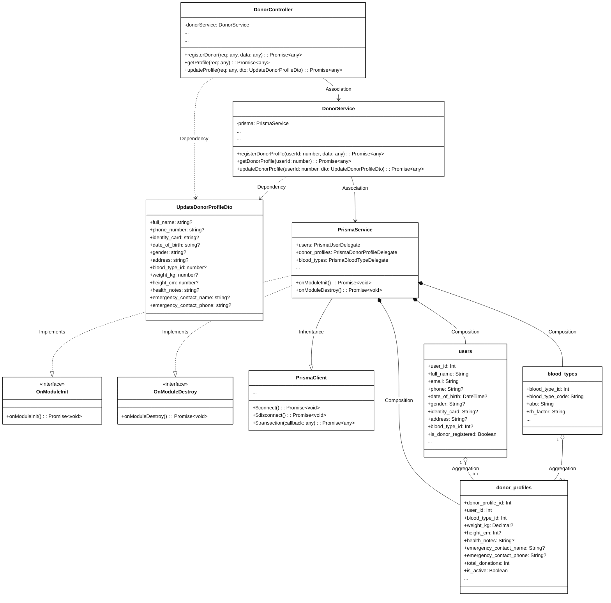
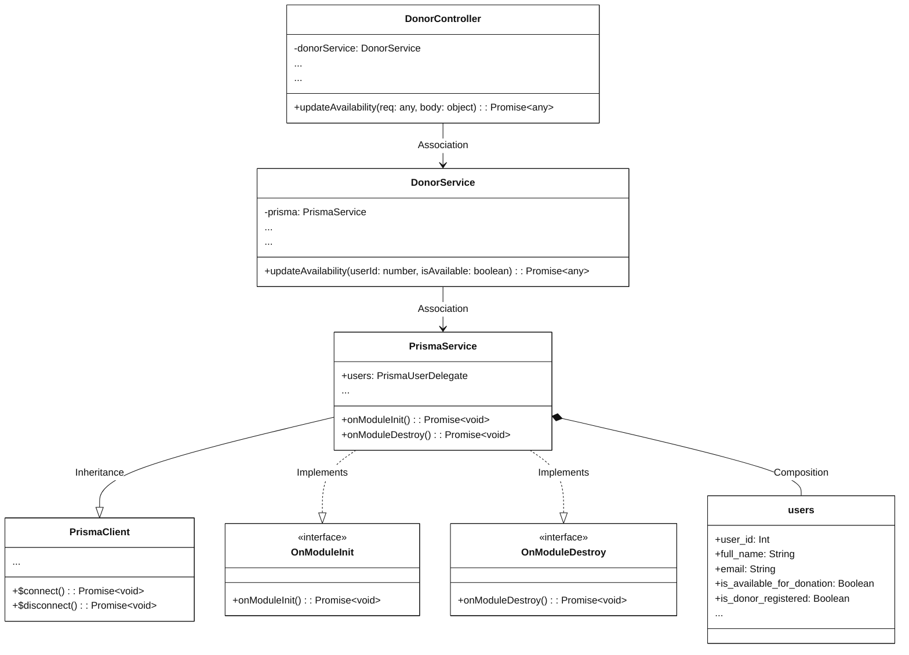
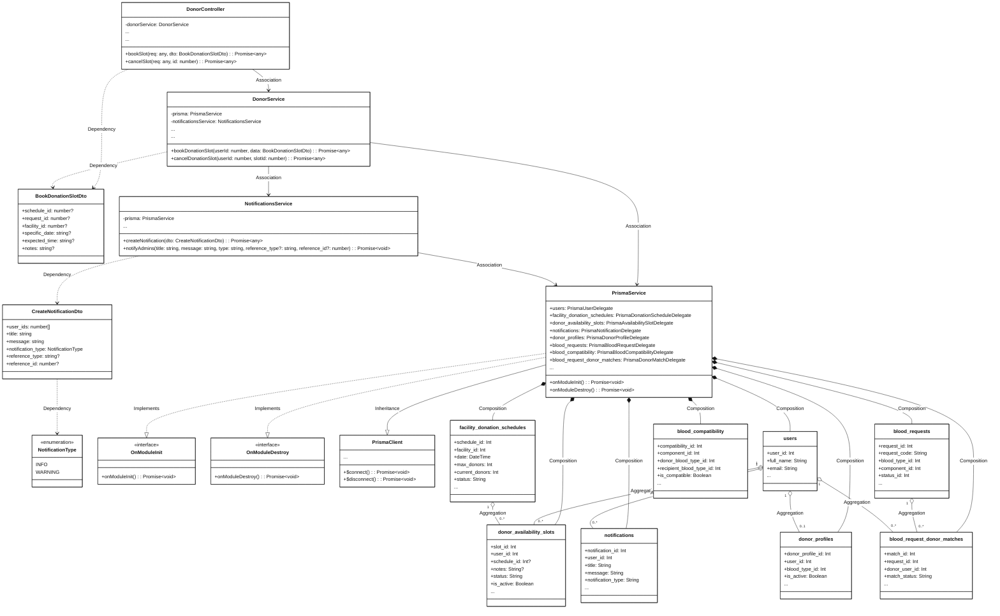
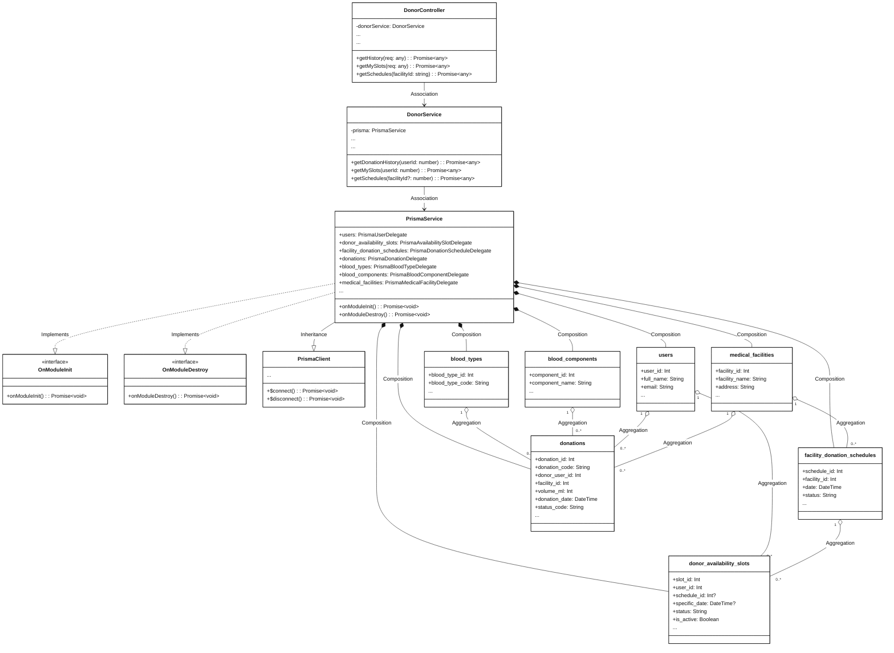
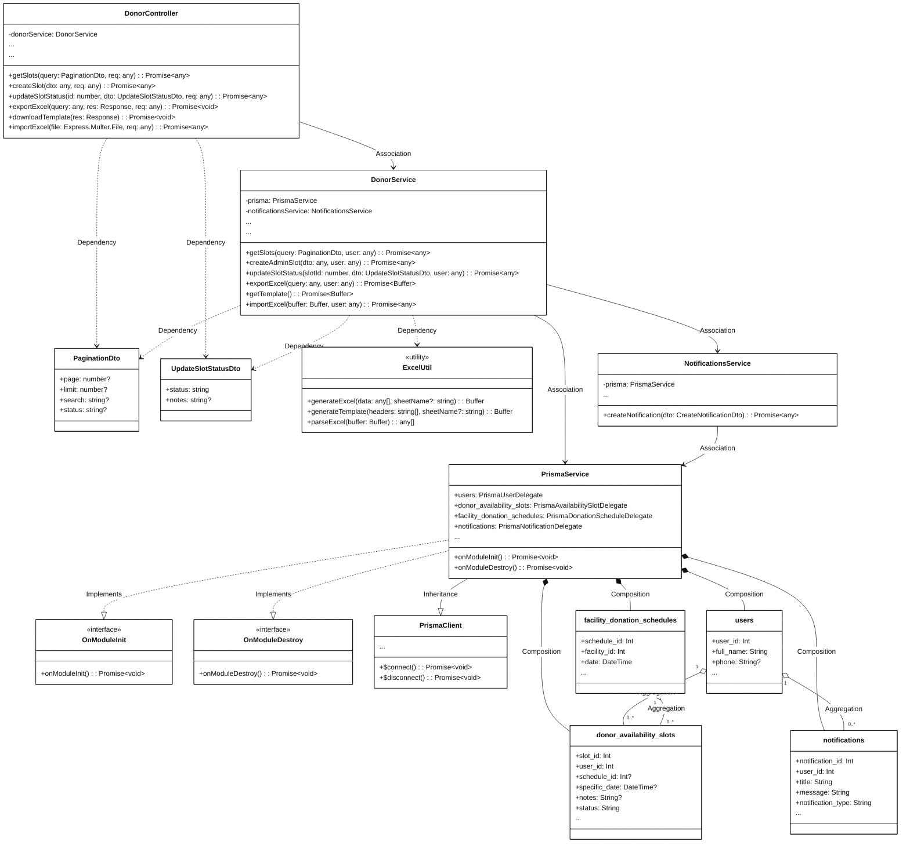
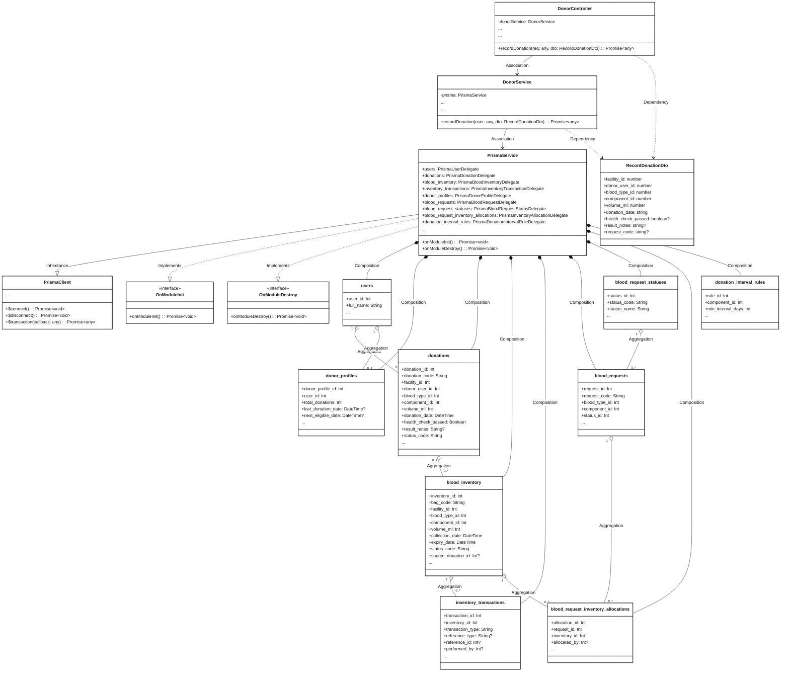

# Module 3.3: Donor Profile, Appointment and Donation Feature (Mermaid)
> Contains 7 class diagrams.

## 3.3.1 Overview Class Diagram - Donor Profile, Appointment and Donation Feature (`donor_overview`)

```mermaid
%%{init: {"theme":"base","themeVariables":{"background":"#ffffff","primaryColor":"#ffffff","primaryTextColor":"#111111","primaryBorderColor":"#111111","lineColor":"#111111","secondaryColor":"#ffffff","tertiaryColor":"#ffffff","edgeLabelBackground":"#ffffff","labelBoxBkgColor":"#ffffff","fontFamily":"Arial"}}}%%
classDiagram
direction TB

class DonorController {
  -donorService: DonorService
  +registerDonor(req: any, data: any): Promise~any~
  +getProfile(req: any): Promise~any~
  +updateProfile(req: any, dto: UpdateDonorProfileDto): Promise~any~
  +updateAvailability(req: any, body: object): Promise~any~
  +bookSlot(req: any, dto: BookDonationSlotDto): Promise~any~
  +cancelSlot(req: any, id: number): Promise~any~
  +getHistory(req: any): Promise~any~
  +getMySlots(req: any): Promise~any~
  +getSchedules(facilityId: string): Promise~any~
  +getSlots(query: PaginationDto, req: any): Promise~any~
  +exportExcel(query: any, res: Response, req: any): Promise~void~
  +downloadTemplate(res: Response): Promise~void~
  +importExcel(file: Express.Multer.File, req: any): Promise~any~
  +createSlot(dto: any, req: any): Promise~any~
  +updateSlotStatus(id: number, dto: UpdateSlotStatusDto, req: any): Promise~any~
  +recordDonation(req: any, dto: RecordDonationDto): Promise~any~
}

class BookDonationSlotDto {
  +schedule_id: number?
  +request_id: number?
  +facility_id: number?
  +specific_date: string?
  +expected_time: string?
  +notes: string?
}

class UpdateSlotStatusDto {
  +status: string
  +notes: string?
}

class RecordDonationDto {
  +facility_id: number
  +donor_user_id: number
  +blood_type_id: number
  +component_id: number
  +volume_ml: number
  +donation_date: string
  +health_check_passed: boolean?
  +result_notes: string?
  +request_code: string?
}

class UpdateDonorProfileDto {
  +full_name: string?
  +phone_number: string?
  +identity_card: string?
  +date_of_birth: string?
  +gender: string?
  +address: string?
  +blood_type_id: number?
  +weight_kg: number?
  +height_cm: number?
  +health_notes: string?
  +emergency_contact_name: string?
  +emergency_contact_phone: string?
}

class PaginationDto {
  +page: number?
  +limit: number?
  +search: string?
}

class DonorService {
  -prisma: PrismaService
  -notificationsService: NotificationsService
  +registerDonorProfile(userId: number, data: any): Promise~any~
  +getDonorProfile(userId: number): Promise~any~
  +updateDonorProfile(userId: number, dto: UpdateDonorProfileDto): Promise~any~
  +updateAvailability(userId: number, isAvailable: boolean): Promise~any~
  +bookDonationSlot(userId: number, data: BookDonationSlotDto): Promise~any~
  +cancelDonationSlot(userId: number, slotId: number): Promise~any~
  +getDonationHistory(userId: number): Promise~any~
  +getMySlots(userId: number): Promise~any~
  +getSchedules(facilityId?: number): Promise~any~
  +getSlots(query: PaginationDto, user: any): Promise~any~
  +createAdminSlot(dto: any, user: any): Promise~any~
  +updateSlotStatus(slotId: number, dto: UpdateSlotStatusDto, user: any): Promise~any~
  +recordDonation(user: any, dto: RecordDonationDto): Promise~any~
  +exportExcel(query: any, user: any): Promise~Buffer~
  +getTemplate(): Promise~Buffer~
  +importExcel(buffer: Buffer, user: any): Promise~any~
}

class blood_requests {
  +request_id: Int
  +request_code: String
  +blood_type_id: Int
  +component_id: Int
  +status_id: Int
  ...
}

class blood_compatibility {
  +compatibility_id: Int
  +component_id: Int
  +donor_blood_type_id: Int
  +recipient_blood_type_id: Int
  +is_compatible: Boolean
  ...
}

class blood_request_donor_matches {
  +match_id: Int
  +request_id: Int
  +donor_user_id: Int
  +match_status: String
  ...
}

class blood_request_statuses {
  +status_id: Int
  +status_code: String
  +status_name: String
  ...
}

class blood_request_inventory_allocations {
  +allocation_id: Int
  +request_id: Int
  +inventory_id: Int
  +allocated_by: Int?
  ...
}

class inventory_transactions {
  +transaction_id: Int
  +inventory_id: Int
  +transaction_type: String
  +reference_type: String?
  +reference_id: Int?
  ...
}

class donation_interval_rules {
  +rule_id: Int
  +component_id: Int
  +min_interval_days: Int
  ...
}

class blood_components {
  +component_id: Int
  +component_code: String
  +component_name: String
  ...
}

class ExcelUtil {
  <<utility>>
  +generateExcel(data: any[], sheetName: string): Buffer
  +generateTemplate(headers: string[], sheetName: string): Buffer
  +parseExcel(buffer: Buffer): any[]
}

class NotificationsService {
  -prisma: PrismaService
  +createNotification(dto: CreateNotificationDto): Promise~any~
  +notifyAdmins(title: string, message: string, type: string, reference_type?: string, reference_id?: number): Promise~void~
  ...
}

class OnModuleInit {
  <<interface>>
  +onModuleInit(): Promise~void~
}

class OnModuleDestroy {
  <<interface>>
  +onModuleDestroy(): Promise~void~
}

class PrismaClient {
  +$connect(): Promise~void~
  +$disconnect(): Promise~void~
  +$transaction(callback: any): Promise~any~
  ...
}

class PrismaService {
  +users: PrismaUserDelegate
  +donor_profiles: PrismaDonorProfileDelegate
  +donor_availability_slots: PrismaAvailabilitySlotDelegate
  +facility_donation_schedules: PrismaDonationScheduleDelegate
  +donations: PrismaDonationDelegate
  +blood_inventory: PrismaBloodInventoryDelegate
  +medical_facilities: PrismaMedicalFacilityDelegate
  +blood_types: PrismaBloodTypeDelegate
  +notifications: PrismaNotificationDelegate
  +blood_requests: PrismaBloodRequestDelegate
  +blood_compatibility: PrismaBloodCompatibilityDelegate
  +blood_request_donor_matches: PrismaDonorMatchDelegate
  +blood_request_statuses: PrismaBloodRequestStatusDelegate
  +blood_request_inventory_allocations: PrismaInventoryAllocationDelegate
  +inventory_transactions: PrismaInventoryTransactionDelegate
  +donation_interval_rules: PrismaDonationIntervalRuleDelegate
  +blood_components: PrismaBloodComponentDelegate
  ...
  +onModuleInit(): Promise~void~
  +onModuleDestroy(): Promise~void~
}

class users {
  +user_id: Int
  +full_name: String
  +email: String
  +phone: String?
  +is_donor_registered: Boolean
  +is_available_for_donation: Boolean
  ...
}

class donor_profiles {
  +donor_profile_id: Int
  +user_id: Int
  +blood_type_id: Int
  +weight_kg: Decimal?
  +height_cm: Int?
  +total_donations: Int
  +last_donation_date: DateTime?
  +next_eligible_date: DateTime?
  +health_notes: String?
  +emergency_contact_name: String?
  +emergency_contact_phone: String?
  +is_active: Boolean
  ...
}

class donor_availability_slots {
  +slot_id: Int
  +user_id: Int
  +schedule_id: Int?
  +specific_date: DateTime?
  +start_time: DateTime?
  +end_time: DateTime?
  +notes: String?
  +status: String
  +is_active: Boolean
  ...
}

class facility_donation_schedules {
  +schedule_id: Int
  +facility_id: Int
  +date: DateTime
  +start_time: DateTime
  +end_time: DateTime
  +max_donors: Int
  +current_donors: Int
  +status: String
  ...
}

class donations {
  +donation_id: Int
  +donation_code: String
  +facility_id: Int
  +donor_user_id: Int
  +blood_type_id: Int
  +component_id: Int
  +volume_ml: Int
  +donation_date: DateTime
  +health_check_passed: Boolean
  +status_code: String
  ...
}

class blood_inventory {
  +inventory_id: Int
  +bag_code: String
  +facility_id: Int
  +blood_type_id: Int
  +component_id: Int
  +volume_ml: Int
  +collection_date: DateTime
  +expiry_date: DateTime
  +status_code: String
  +source_donation_id: Int?
  ...
}

class medical_facilities {
  +facility_id: Int
  +facility_code: String
  +facility_name: String
  +phone: String?
  +address: String
  ...
}

class blood_types {
  +blood_type_id: Int
  +blood_type_code: String
  +abo: String
  +rh_factor: String
  ...
}

class notifications {
  +notification_id: Int
  +user_id: Int
  +title: String
  +message: String
  +notification_type: String
  ...
}

DonorController --> DonorService : Association
DonorController ..> BookDonationSlotDto : Dependency
DonorController ..> UpdateSlotStatusDto : Dependency
DonorController ..> RecordDonationDto : Dependency
DonorController ..> UpdateDonorProfileDto : Dependency
DonorController ..> PaginationDto : Dependency

DonorService --> PrismaService : Association
DonorService --> NotificationsService : Association
DonorService ..> BookDonationSlotDto : Dependency
DonorService ..> UpdateSlotStatusDto : Dependency
DonorService ..> RecordDonationDto : Dependency
DonorService ..> UpdateDonorProfileDto : Dependency
DonorService ..> PaginationDto : Dependency
DonorService ..> ExcelUtil : Dependency

NotificationsService --> PrismaService : Association

PrismaService --|> PrismaClient : Inheritance
PrismaService ..|> OnModuleInit : Implements
PrismaService ..|> OnModuleDestroy : Implements

PrismaService *-- users : Composition
PrismaService *-- donor_profiles : Composition
PrismaService *-- donor_availability_slots : Composition
PrismaService *-- facility_donation_schedules : Composition
PrismaService *-- donations : Composition
PrismaService *-- blood_inventory : Composition
PrismaService *-- medical_facilities : Composition
PrismaService *-- blood_types : Composition
PrismaService *-- notifications : Composition

users "1" o-- "0..1" donor_profiles : Aggregation
blood_types "1" o-- "0..*" donor_profiles : Aggregation
users "1" o-- "0..*" donor_availability_slots : Aggregation
facility_donation_schedules "1" o-- "0..*" donor_availability_slots : Aggregation
medical_facilities "1" o-- "0..*" facility_donation_schedules : Aggregation
users "1" o-- "0..*" donations : Aggregation
medical_facilities "1" o-- "0..*" donations : Aggregation
donations "0..1" o-- "0..*" blood_inventory : Aggregation
users "1" o-- "0..*" notifications : Aggregation
PrismaService *-- blood_requests : Composition
PrismaService *-- blood_compatibility : Composition
PrismaService *-- blood_request_donor_matches : Composition
PrismaService *-- blood_request_statuses : Composition
PrismaService *-- blood_request_inventory_allocations : Composition
PrismaService *-- inventory_transactions : Composition
PrismaService *-- donation_interval_rules : Composition
PrismaService *-- blood_components : Composition

blood_requests "1" o-- "0..*" blood_request_donor_matches : Aggregation
users "1" o-- "0..*" blood_request_donor_matches : Aggregation
blood_request_statuses "1" o-- "0..*" blood_requests : Aggregation
blood_requests "1" o-- "0..*" blood_request_inventory_allocations : Aggregation
blood_inventory "1" o-- "0..*" blood_request_inventory_allocations : Aggregation
blood_inventory "1" o-- "0..*" inventory_transactions : Aggregation
blood_components "1" o-- "0..*" donations : Aggregation
blood_components "1" o-- "0..*" blood_compatibility : Aggregation
blood_types "1" o-- "0..*" blood_compatibility : Aggregation
blood_components "1" o-- "0..1" donation_interval_rules : Aggregation
```

## 3.3.2.1 Class Diagram - Register and Update Donor Profile (`donor_profile`)

## 3.3.2.2 Class Diagram - Update Donor Availability (`donor_availability`)

## 3.3.2.3 Class Diagram - Book and Cancel Donation Slot (`donor_booking`)

## 3.3.2.4 Class Diagram - View My Slots and History (`donor_history_slots`)

## 3.3.2.5 Class Diagram - Admin Manage Slots and Excel (`donor_admin_slots_excel`)

## 3.3.2.6 Class Diagram - Record Blood Donation (`donor_record_donation`)

