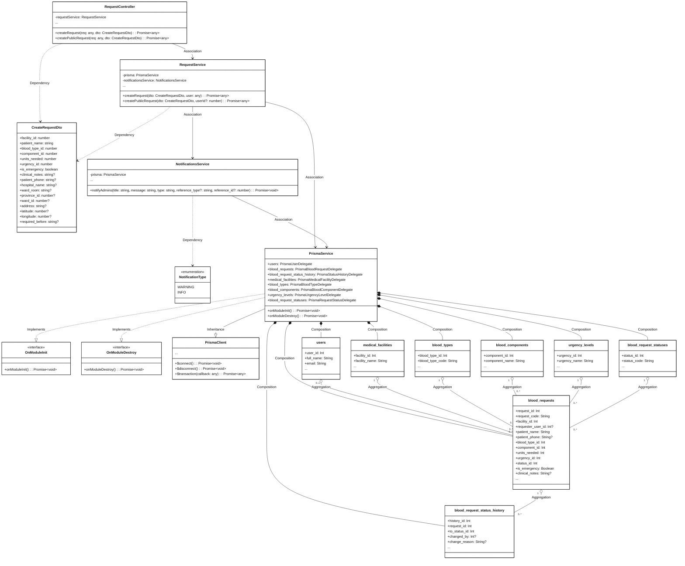
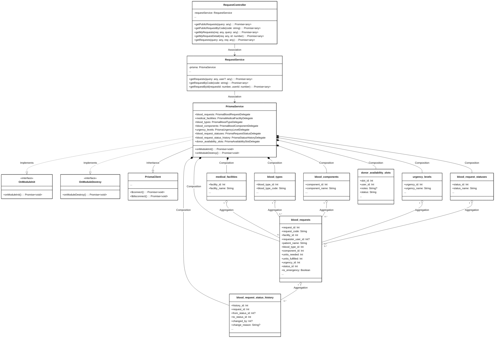
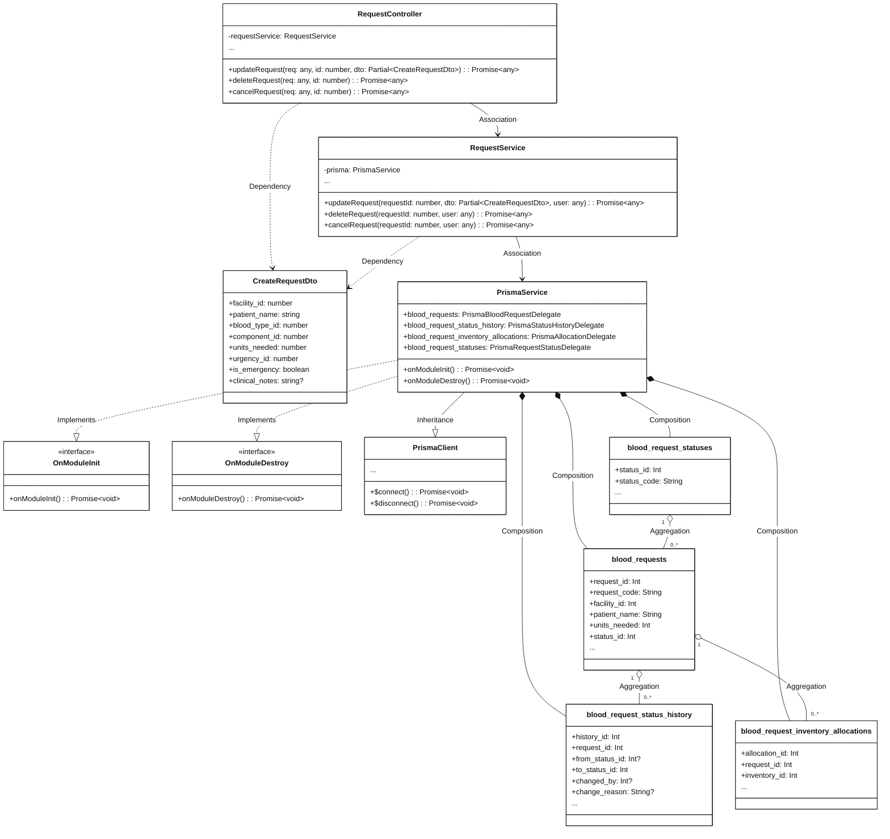
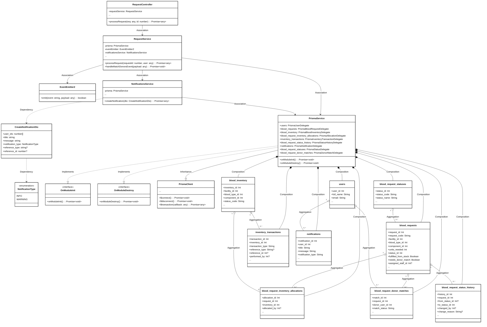
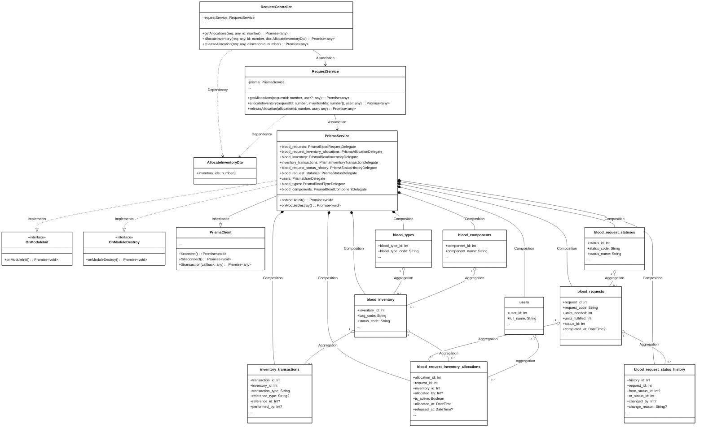
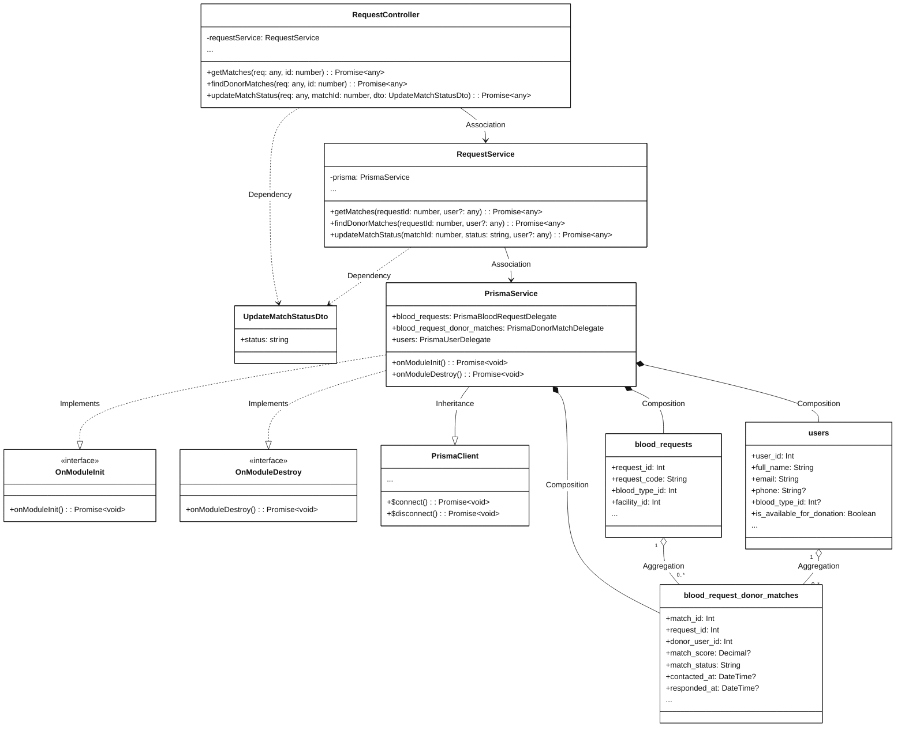
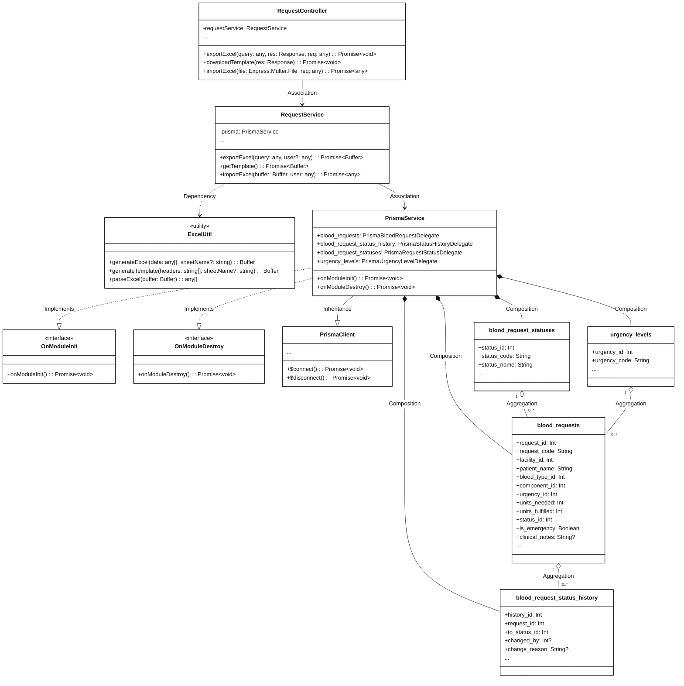

# Module 3.4: Blood Request and Matching Feature (Mermaid)
> Contains 8 class diagrams.

## 3.4.1 Overview Class Diagram - Blood Request and Matching Feature (`request_overview`)

```mermaid
%%{init: {"theme":"base","themeVariables":{"background":"#ffffff","primaryColor":"#ffffff","primaryTextColor":"#111111","primaryBorderColor":"#111111","lineColor":"#111111","secondaryColor":"#ffffff","tertiaryColor":"#ffffff","edgeLabelBackground":"#ffffff","labelBoxBkgColor":"#ffffff","fontFamily":"Arial"}}}%%
classDiagram
direction TB

class RequestController {
  -requestService: RequestService
  +createRequest(req: any, dto: CreateRequestDto): Promise~any~
  +createPublicRequest(req: any, dto: CreateRequestDto): Promise~any~
  +getPublicRequests(query: any): Promise~any~
  +getPublicRequestByCode(code: string): Promise~any~
  +processRequest(req: any, id: number): Promise~any~
  +getMyRequests(req: any, query: any): Promise~any~
  +getMyRequestDetail(req: any, id: number): Promise~any~
  +getRequests(query: any, req: any): Promise~any~
  +exportExcel(query: any, res: Response, req: any): Promise~void~
  +downloadTemplate(res: Response): Promise~void~
  +importExcel(file: Express.Multer.File, req: any): Promise~any~
  +updateRequest(req: any, id: number, dto: Partial~CreateRequestDto~): Promise~any~
  +deleteRequest(req: any, id: number): Promise~any~
  +cancelRequest(req: any, id: number): Promise~any~
  +getMatches(req: any, id: number): Promise~any~
  +findDonorMatches(req: any, id: number): Promise~any~
  +updateMatchStatus(req: any, matchId: number, dto: UpdateMatchStatusDto): Promise~any~
  +getAllocations(req: any, id: number): Promise~any~
  +allocateInventory(req: any, id: number, dto: AllocateInventoryDto): Promise~any~
  +releaseAllocation(req: any, allocationId: number): Promise~any~
}

class CreateRequestDto {
  +facility_id: number
  +patient_name: string
  +blood_type_id: number
  +component_id: number
  +units_needed: number
  +urgency_id: number
  +is_emergency: boolean
  +clinical_notes: string?
  +patient_phone: string?
  +hospital_name: string?
  +ward_room: string?
  +province_id: number?
  +ward_id: number?
  +address: string?
  +latitude: number?
  +longitude: number?
  +required_before: string?
}

class UpdateMatchStatusDto {
  +status: string
}

class AllocateInventoryDto {
  +inventory_ids: number[]
}

class RequestService {
  -prisma: PrismaService
  -eventEmitter: EventEmitter2
  -notificationsService: NotificationsService
  +createRequest(dto: CreateRequestDto, user: any): Promise~any~
  +createPublicRequest(dto: CreateRequestDto, userId?: number): Promise~any~
  +processRequest(requestId: number, user: any): Promise~any~
  +getRequestByCode(code: string): Promise~any~
  +getRequests(query: any, user?: any): Promise~any~
  +exportExcel(query: any, user?: any): Promise~Buffer~
  +getTemplate(): Promise~Buffer~
  +importExcel(buffer: Buffer, user: any): Promise~any~
  +updateRequest(requestId: number, dto: Partial~CreateRequestDto~, user: any): Promise~any~
  +deleteRequest(requestId: number, user: any): Promise~any~
  +cancelRequest(requestId: number, user: any): Promise~any~
  +getRequestById(requestId: number, userId: number): Promise~any~
  +getMatches(requestId: number, user?: any): Promise~any~
  +findDonorMatches(requestId: number, user?: any): Promise~any~
  +updateMatchStatus(matchId: number, status: string, user?: any): Promise~any~
  +getAllocations(requestId: number, user?: any): Promise~any~
  +allocateInventory(requestId: number, inventoryIds: number[], user: any): Promise~any~
  +releaseAllocation(allocationId: number, user: any): Promise~any~
  +handleMatchDonorsEvent(payload: any): Promise~void~
}

class EventEmitter2 {
  +emit(event: string, payload: any): boolean
}

class donor_availability_slots {
  +slot_id: Int
  +user_id: Int
  +schedule_id: Int?
  +status: String
  ...
}

class provinces {
  +province_id: Int
  +province_name: String
  ...
}

class wards {
  +ward_id: Int
  +province_id: Int
  +ward_name: String
  ...
}

class ExcelUtil {
  <<utility>>
  +generateExcel(data: any[], sheetName: string): Buffer
  +generateTemplate(headers: string[], sheetName: string): Buffer
  +parseExcel(buffer: Buffer): any[]
}

class NotificationsService {
  -prisma: PrismaService
  +createNotification(dto: CreateNotificationDto): Promise~any~
  +notifyAdmins(title: string, message: string, type: string, reference_type?: string, reference_id?: number): Promise~void~
  ...
}

class OnModuleInit {
  <<interface>>
  +onModuleInit(): Promise~void~
}

class OnModuleDestroy {
  <<interface>>
  +onModuleDestroy(): Promise~void~
}

class PrismaClient {
  +$connect(): Promise~void~
  +$disconnect(): Promise~void~
  +$transaction(callback: any): Promise~any~
  ...
}

class PrismaService {
  +blood_requests: PrismaBloodRequestDelegate
  +blood_request_status_history: PrismaStatusHistoryDelegate
  +blood_request_donor_matches: PrismaDonorMatchDelegate
  +blood_request_inventory_allocations: PrismaAllocationDelegate
  +blood_inventory: PrismaBloodInventoryDelegate
  +inventory_transactions: PrismaInventoryTransactionDelegate
  +medical_facilities: PrismaMedicalFacilityDelegate
  +blood_types: PrismaBloodTypeDelegate
  +blood_components: PrismaBloodComponentDelegate
  +urgency_levels: PrismaUrgencyLevelDelegate
  +blood_request_statuses: PrismaRequestStatusDelegate
  +users: PrismaUserDelegate
  +notifications: PrismaNotificationDelegate
  +donor_availability_slots: PrismaAvailabilitySlotDelegate
  +provinces: PrismaProvinceDelegate
  +wards: PrismaWardDelegate
  +onModuleInit(): Promise~void~
  +onModuleDestroy(): Promise~void~
}

class blood_requests {
  +request_id: Int
  +request_code: String
  +facility_id: Int
  +requester_user_id: Int?
  +patient_name: String
  +patient_phone: String?
  +blood_type_id: Int
  +component_id: Int
  +units_needed: Int
  +units_fulfilled: Int
  +urgency_id: Int
  +status_id: Int
  +is_emergency: Boolean
  +hospital_name: String?
  +ward_room: String?
  +clinical_notes: String?
  +fulfilled_from_stock: Boolean
  +needs_donor_match: Boolean
  +assigned_staff_id: Int?
  +created_at: DateTime
  ...
}

class blood_request_status_history {
  +history_id: Int
  +request_id: Int
  +from_status_id: Int?
  +to_status_id: Int
  +changed_by: Int?
  +change_reason: String?
  +created_at: DateTime
  ...
}

class blood_request_donor_matches {
  +match_id: Int
  +request_id: Int
  +donor_user_id: Int
  +match_score: Decimal?
  +match_status: String
  +contacted_at: DateTime?
  +responded_at: DateTime?
  ...
}

class blood_request_inventory_allocations {
  +allocation_id: Int
  +request_id: Int
  +inventory_id: Int
  +allocated_by: Int?
  +is_active: Boolean
  +allocated_at: DateTime
  +released_at: DateTime?
  ...
}

class blood_inventory {
  +inventory_id: Int
  +facility_id: Int
  +blood_type_id: Int
  +component_id: Int
  +bag_code: String
  +volume_ml: Int
  +status_code: String
  ...
}

class inventory_transactions {
  +transaction_id: Int
  +inventory_id: Int
  +transaction_type: String
  +reference_type: String?
  +reference_id: Int?
  +performed_by: Int?
  ...
}

class medical_facilities {
  +facility_id: Int
  +facility_code: String
  +facility_name: String
  +phone: String?
  +address: String
  ...
}

class blood_types {
  +blood_type_id: Int
  +blood_type_code: String
  +abo: String
  +rh_factor: String
  ...
}

class blood_components {
  +component_id: Int
  +component_code: String
  +component_name: String
  ...
}

class urgency_levels {
  +urgency_id: Int
  +urgency_code: String
  +urgency_name: String
  ...
}

class blood_request_statuses {
  +status_id: Int
  +status_code: String
  +status_name: String
  ...
}

class users {
  +user_id: Int
  +full_name: String
  +email: String
  +phone: String?
  +is_available_for_donation: Boolean
  ...
}

class notifications {
  +notification_id: Int
  +user_id: Int
  +title: String
  +message: String
  +notification_type: String
  ...
}

RequestController --> RequestService : Association
RequestController ..> CreateRequestDto : Dependency
RequestController ..> UpdateMatchStatusDto : Dependency
RequestController ..> AllocateInventoryDto : Dependency
RequestController ..> ExcelUtil : Dependency

RequestService --> PrismaService : Association
RequestService --> NotificationsService : Association
RequestService --> EventEmitter2 : Association
RequestService ..> CreateRequestDto : Dependency
RequestService ..> UpdateMatchStatusDto : Dependency
RequestService ..> AllocateInventoryDto : Dependency
RequestService ..> ExcelUtil : Dependency

NotificationsService --> PrismaService : Association

PrismaService --|> PrismaClient : Inheritance
PrismaService ..|> OnModuleInit : Implements
PrismaService ..|> OnModuleDestroy : Implements

PrismaService *-- blood_requests : Composition
PrismaService *-- blood_request_status_history : Composition
PrismaService *-- blood_request_donor_matches : Composition
PrismaService *-- blood_request_inventory_allocations : Composition
PrismaService *-- blood_inventory : Composition
PrismaService *-- inventory_transactions : Composition
PrismaService *-- medical_facilities : Composition
PrismaService *-- blood_types : Composition
PrismaService *-- blood_components : Composition
PrismaService *-- urgency_levels : Composition
PrismaService *-- blood_request_statuses : Composition
PrismaService *-- users : Composition
PrismaService *-- notifications : Composition

users "0..1" o-- "0..*" blood_requests : Aggregation
medical_facilities "1" o-- "0..*" blood_requests : Aggregation
blood_types "1" o-- "0..*" blood_requests : Aggregation
blood_components "1" o-- "0..*" blood_requests : Aggregation
urgency_levels "1" o-- "0..*" blood_requests : Aggregation
blood_request_statuses "1" o-- "0..*" blood_requests : Aggregation
blood_requests "1" o-- "0..*" blood_request_status_history : Aggregation
blood_requests "1" o-- "0..*" blood_request_donor_matches : Aggregation
users "1" o-- "0..*" blood_request_donor_matches : Aggregation
blood_requests "1" o-- "0..*" blood_request_inventory_allocations : Aggregation
blood_inventory "1" o-- "0..*" blood_request_inventory_allocations : Aggregation
blood_inventory "1" o-- "0..*" inventory_transactions : Aggregation
users "1" o-- "0..*" notifications : Aggregation
PrismaService *-- donor_availability_slots : Composition
PrismaService *-- provinces : Composition
PrismaService *-- wards : Composition

provinces "1" o-- "0..*" wards : Aggregation
provinces "0..1" o-- "0..*" blood_requests : Aggregation
wards "0..1" o-- "0..*" blood_requests : Aggregation
users "1" o-- "0..*" donor_availability_slots : Aggregation
```

## 3.4.2.1 Class Diagram - Create Blood Request (`request_create`)

## 3.4.2.2 Class Diagram - View and Track Requests (`request_view_track`)

## 3.4.2.3 Class Diagram - Update, Cancel and Delete Request (`request_crud`)

## 3.4.2.4 Class Diagram - Process Blood Request (`request_process`)

## 3.4.2.5 Class Diagram - Inventory Allocation and Release (`request_allocations`)

## 3.4.2.6 Class Diagram - Find and Manage Donor Matches (`request_matches`)

## 3.4.2.7 Class Diagram - Import and Export Requests Excel (`request_excel`)

