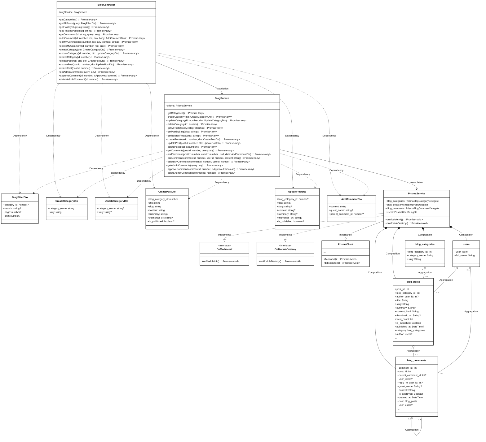
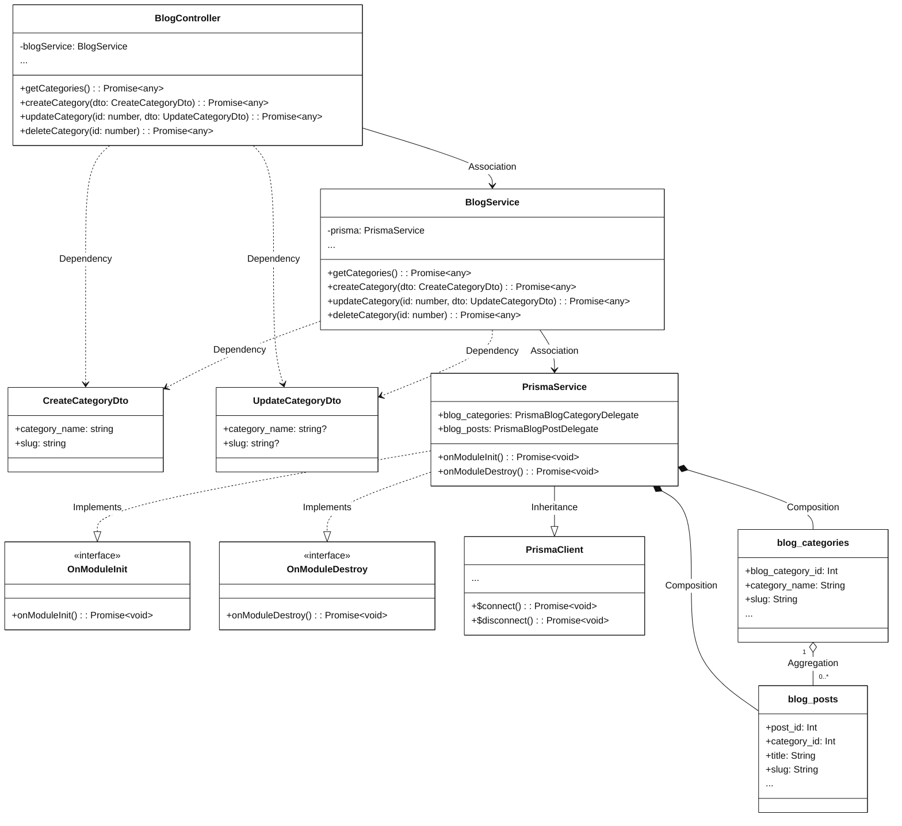
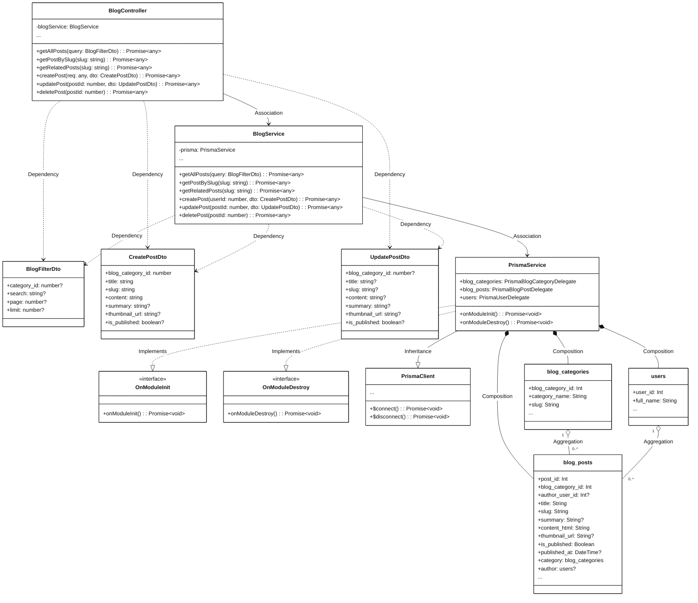
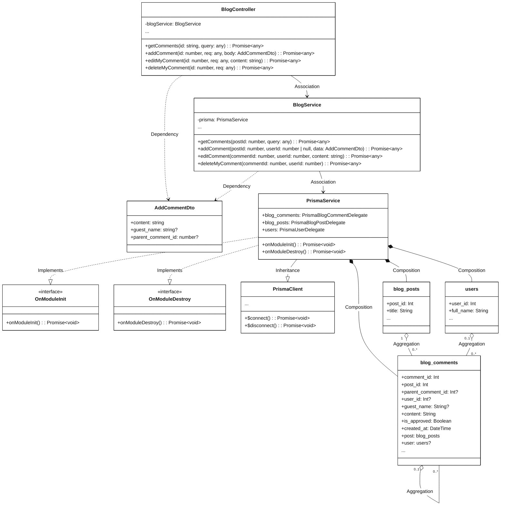
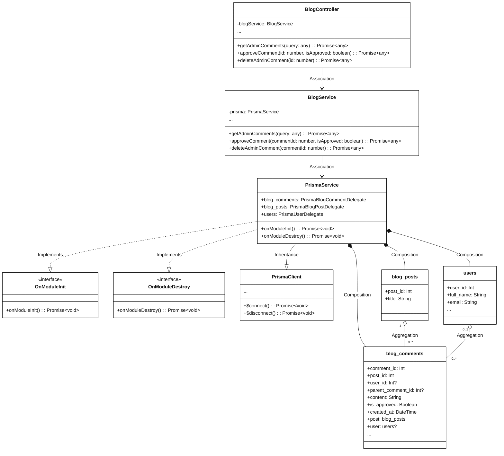

# Module 3.8: Blog Content Feature (Mermaid)
> Contains 5 class diagrams.

## 3.8.1 Overview Class Diagram - Blog Content Feature (`blog_overview`)

## 3.8.2.1 Class Diagram - Manage Blog Categories (`blog_categories`)

## 3.8.2.2 Class Diagram - View and Manage Blog Posts (`blog_posts`)

## 3.8.2.3 Class Diagram - User Comment Interactions (`blog_comments_user`)

## 3.8.2.4 Class Diagram - Admin Comment Moderation (`blog_comments_admin`)

