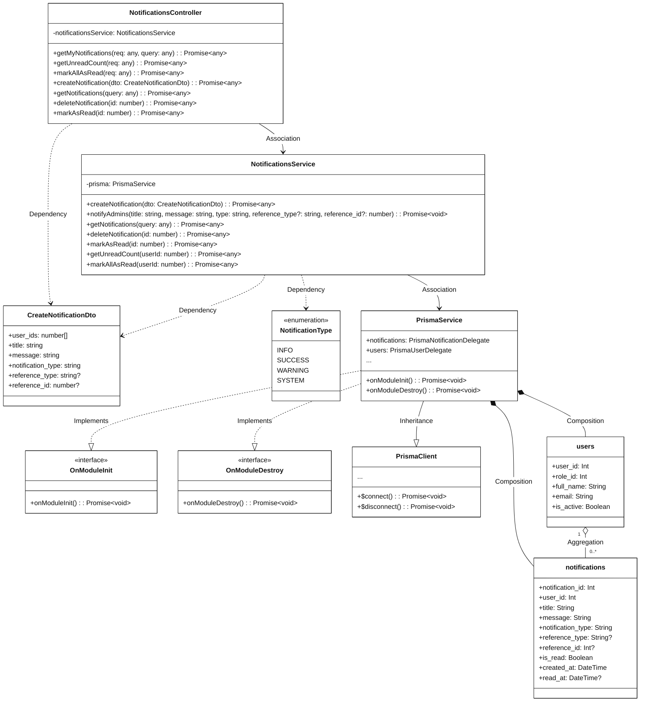
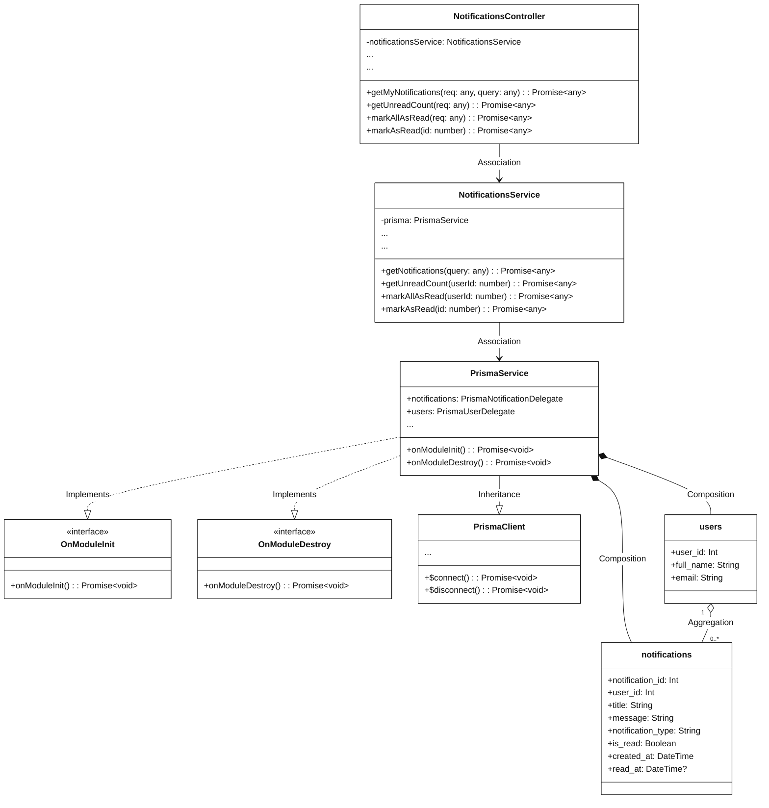
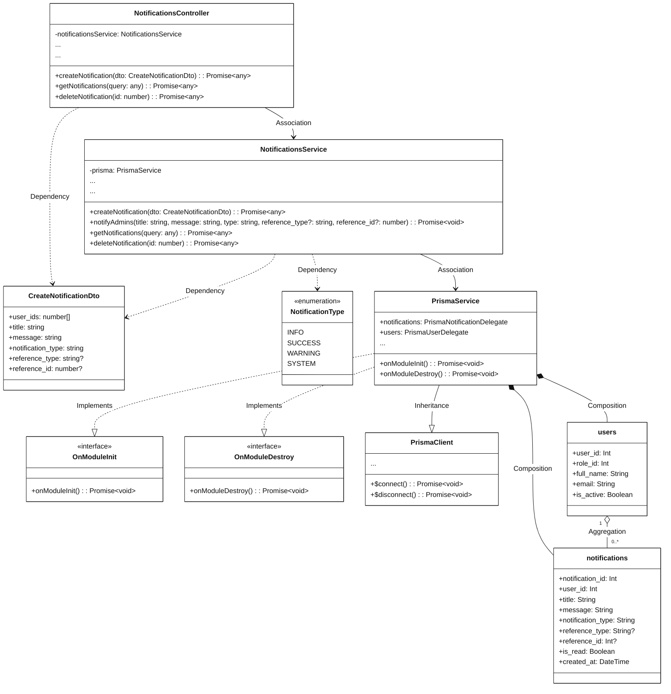

# Module 3.11: Notification Feature (Mermaid)
> Contains 3 class diagrams.

## 3.11.1 Overview Class Diagram - Notification Feature (`notifications_overview`)

## 3.11.2.1 Class Diagram - User Notification Operations (`notifications_user`)

## 3.11.2.2 Class Diagram - Admin Notification Management (`notifications_admin`)

