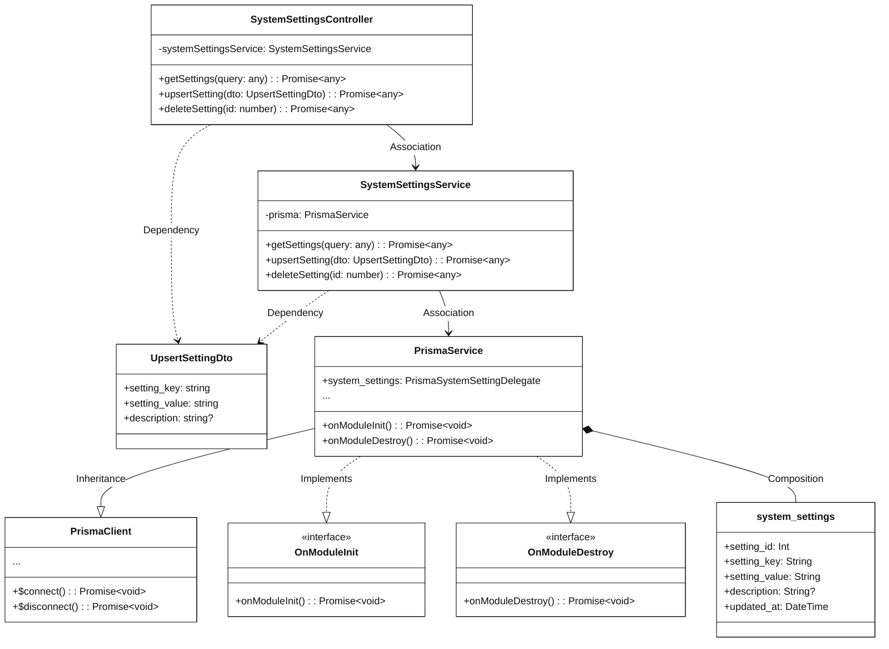

# Module 3.12: System Settings Feature (Mermaid)
> Contains 2 class diagrams.

## 3.12.1 Overview Class Diagram - System Settings Feature (`system_settings_overview`)

## 3.12.2.1 Class Diagram - View and Update System Settings (`system_settings_crud`)

