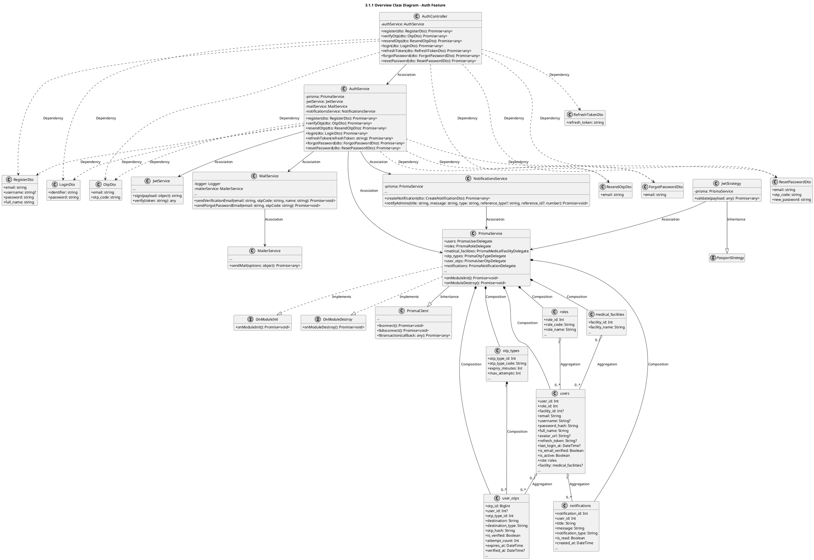
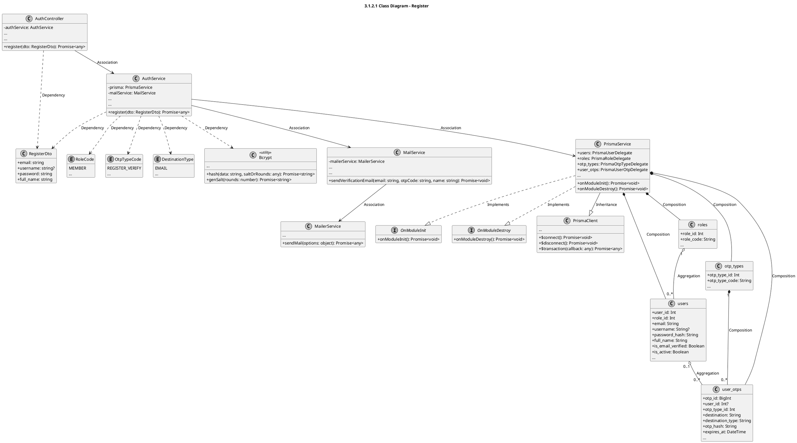
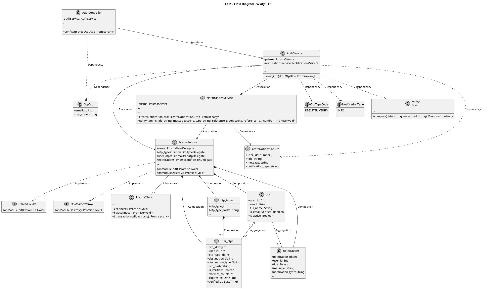
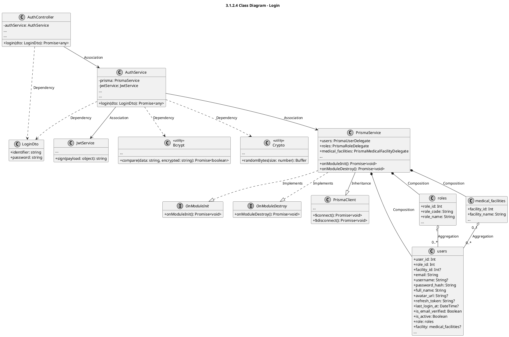
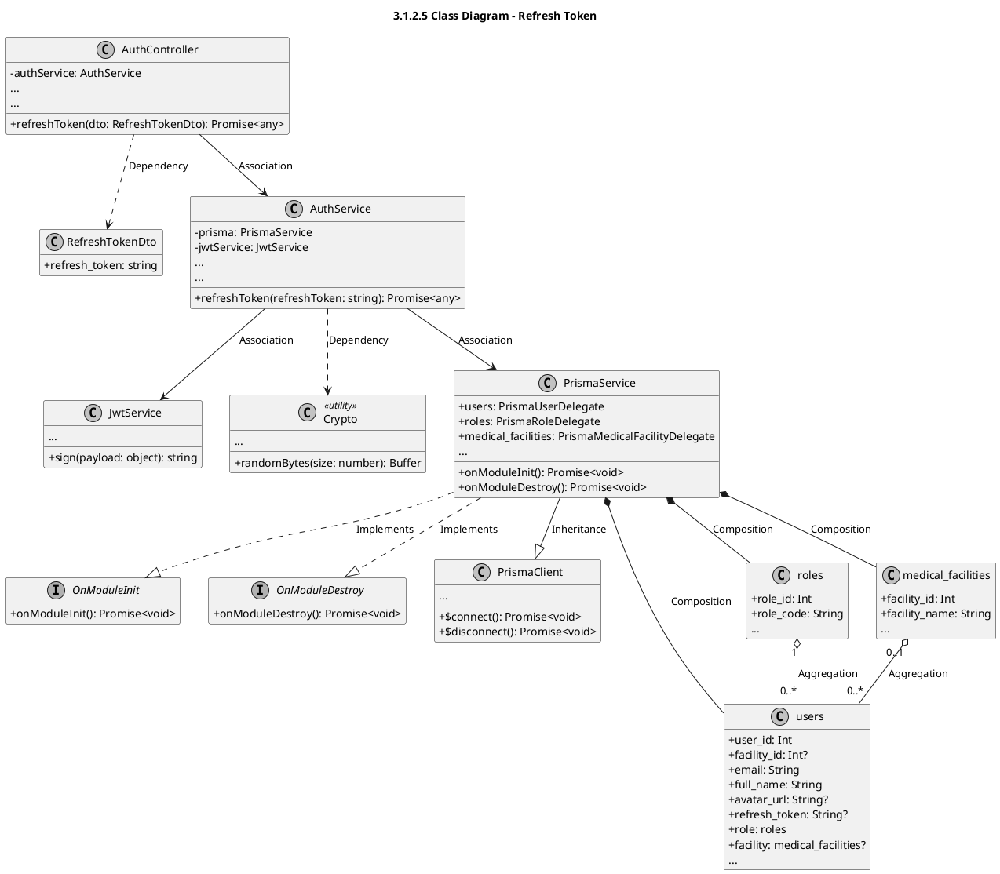
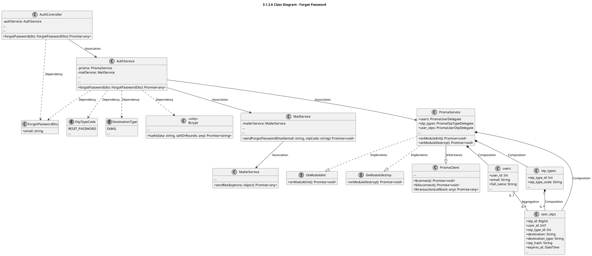
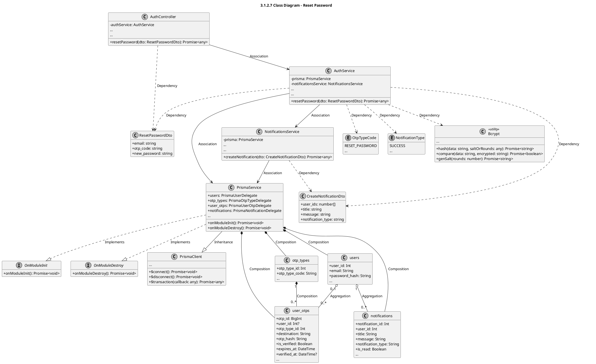

# Module 3.1: Auth Feature (PlantUML)
> Contains 8 class diagrams.

## 3.1.1 Overview Class Diagram - Auth Feature (`auth_overview`)

## 3.1.2.1 Class Diagram - Register (`auth_register`)

## 3.1.2.2 Class Diagram - Verify OTP (`auth_verify_otp`)

## 3.1.2.3 Class Diagram - Resend OTP (`auth_resend_otp`)

## 3.1.2.4 Class Diagram - Login (`auth_login`)

## 3.1.2.5 Class Diagram - Refresh Token (`auth_refresh_token`)

## 3.1.2.6 Class Diagram - Forgot Password (`auth_forgot_password`)

## 3.1.2.7 Class Diagram - Reset Password (`auth_reset_password`)

