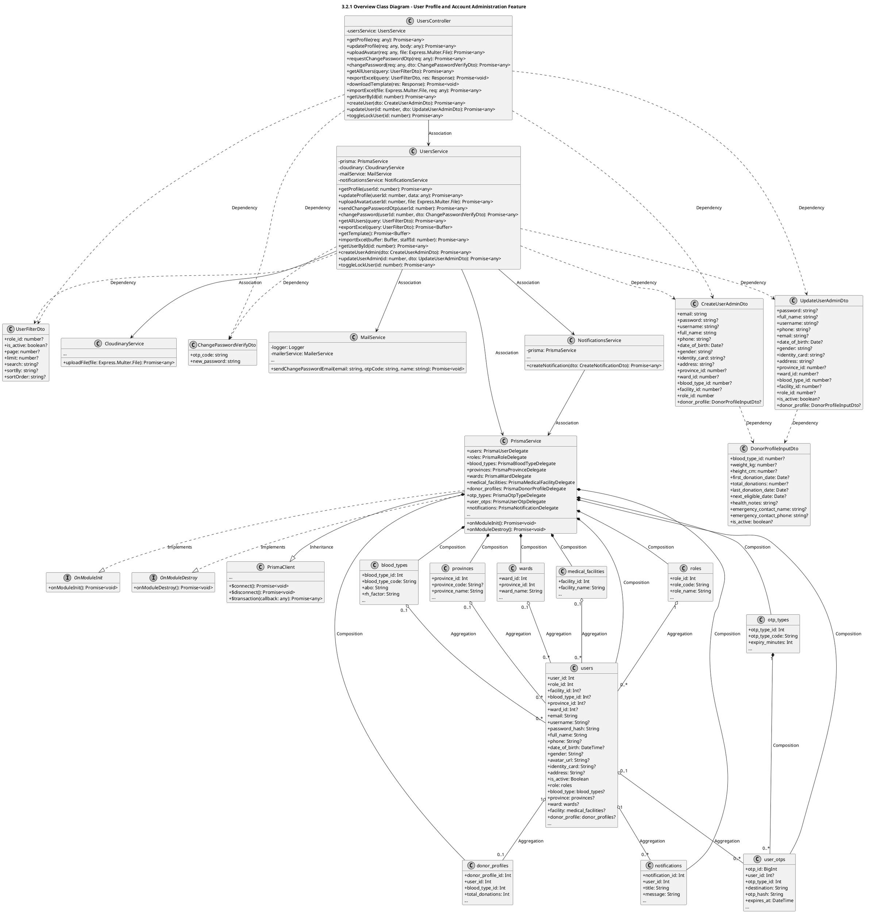
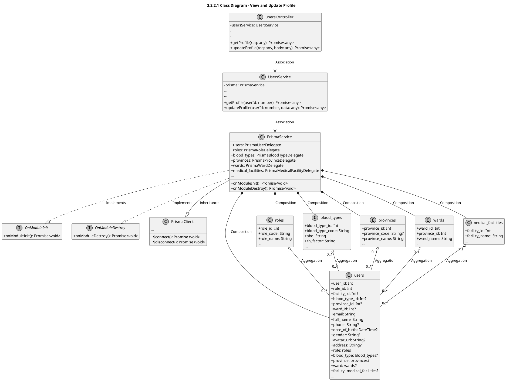
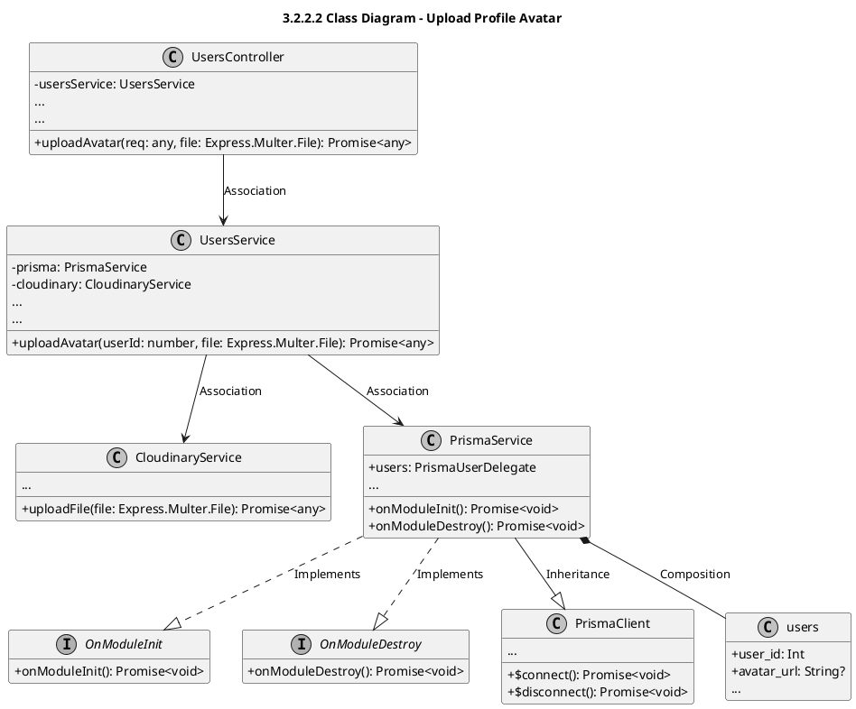
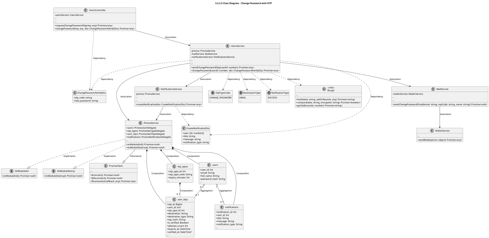
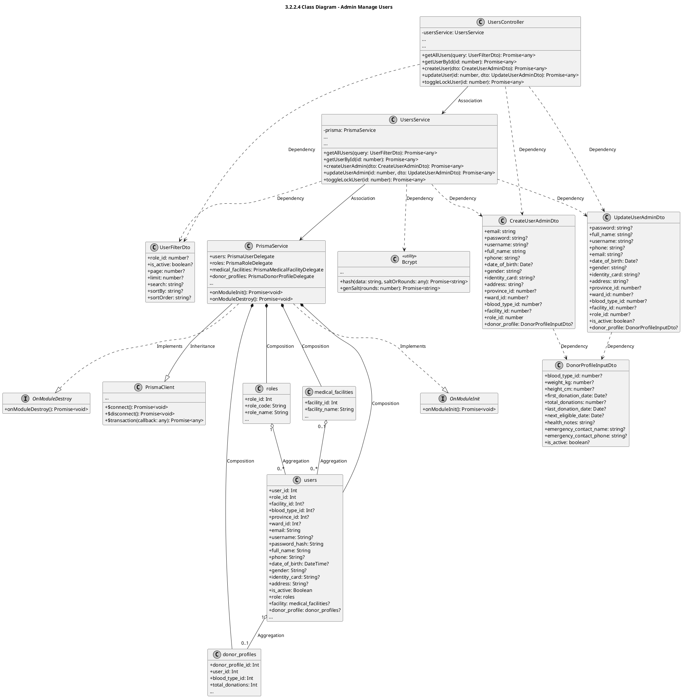
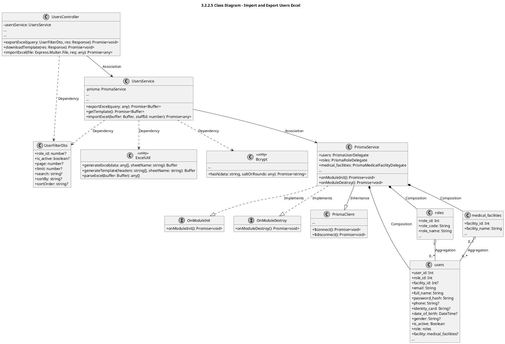

# Module 3.2: User Profile and Account Administration Feature (PlantUML)
> Contains 6 class diagrams.

## 3.2.1 Overview Class Diagram - User Profile and Account Administration Feature (`users_overview`)

## 3.2.2.1 Class Diagram - View and Update Profile (`users_profile`)

## 3.2.2.2 Class Diagram - Upload Profile Avatar (`users_avatar`)

## 3.2.2.3 Class Diagram - Change Password with OTP (`users_change_password`)

## 3.2.2.4 Class Diagram - Admin Manage Users (`users_admin_manage`)

## 3.2.2.5 Class Diagram - Import and Export Users Excel (`users_excel`)

