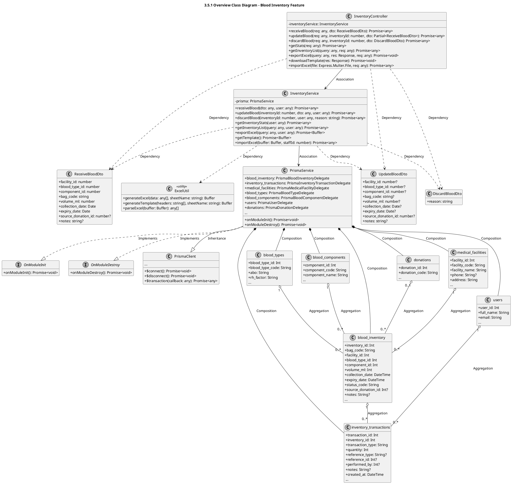
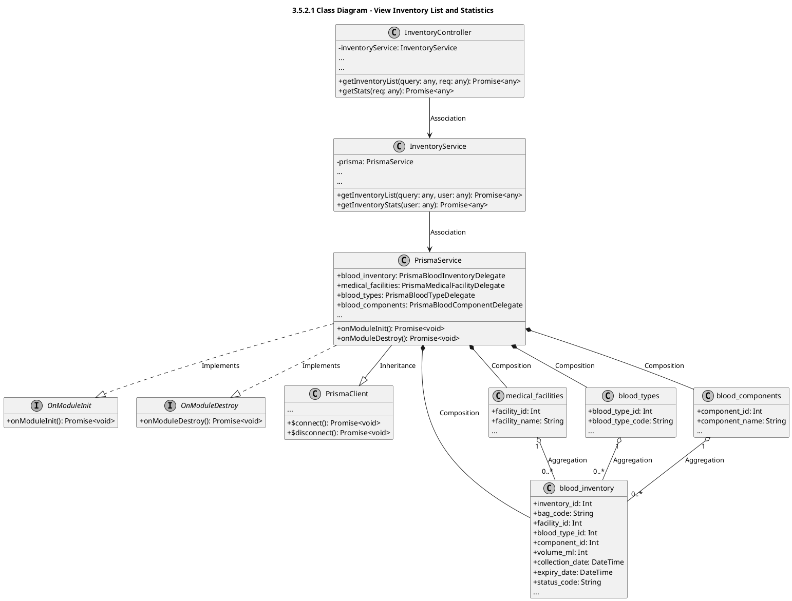
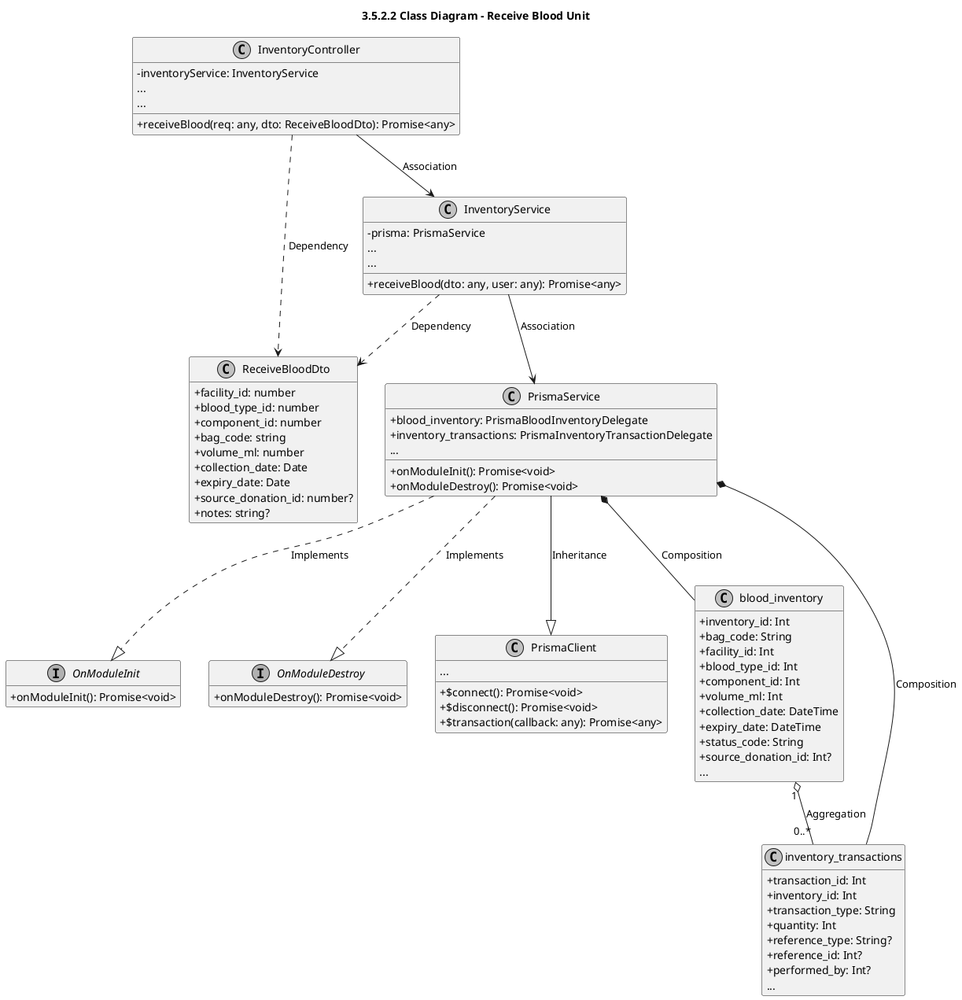
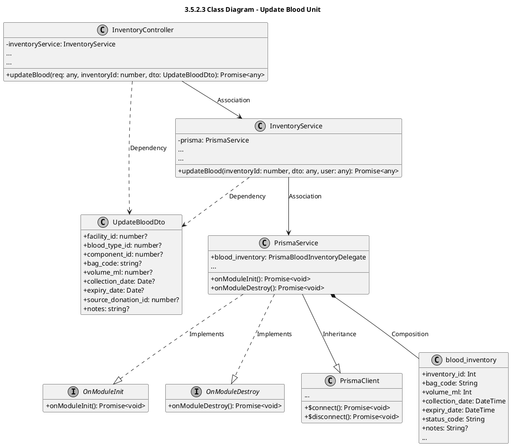
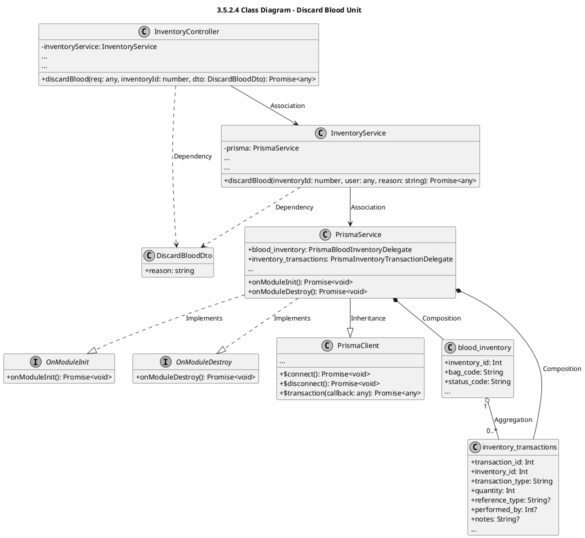
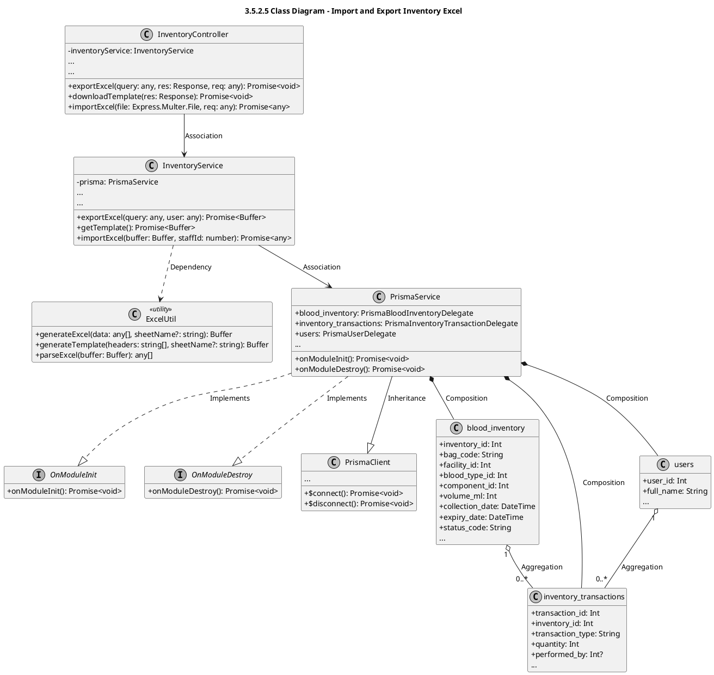

# Module 3.5: Blood Inventory Feature (PlantUML)
> Contains 6 class diagrams.

## 3.5.1 Overview Class Diagram - Blood Inventory Feature (`inventory_overview`)

## 3.5.2.1 Class Diagram - View Inventory List and Statistics (`inventory_list_stats`)

## 3.5.2.2 Class Diagram - Receive Blood Unit (`inventory_receive`)

## 3.5.2.3 Class Diagram - Update Blood Unit (`inventory_update`)

## 3.5.2.4 Class Diagram - Discard Blood Unit (`inventory_discard`)

## 3.5.2.5 Class Diagram - Import and Export Inventory Excel (`inventory_excel`)

