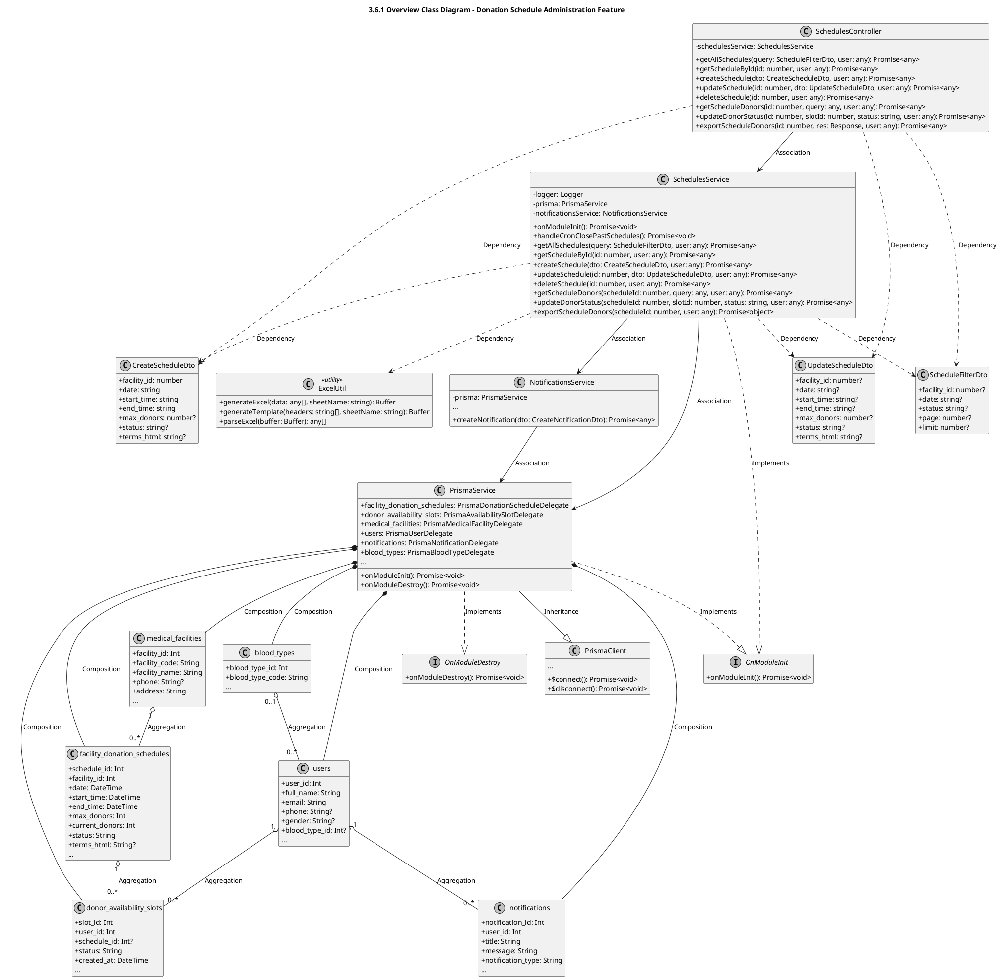
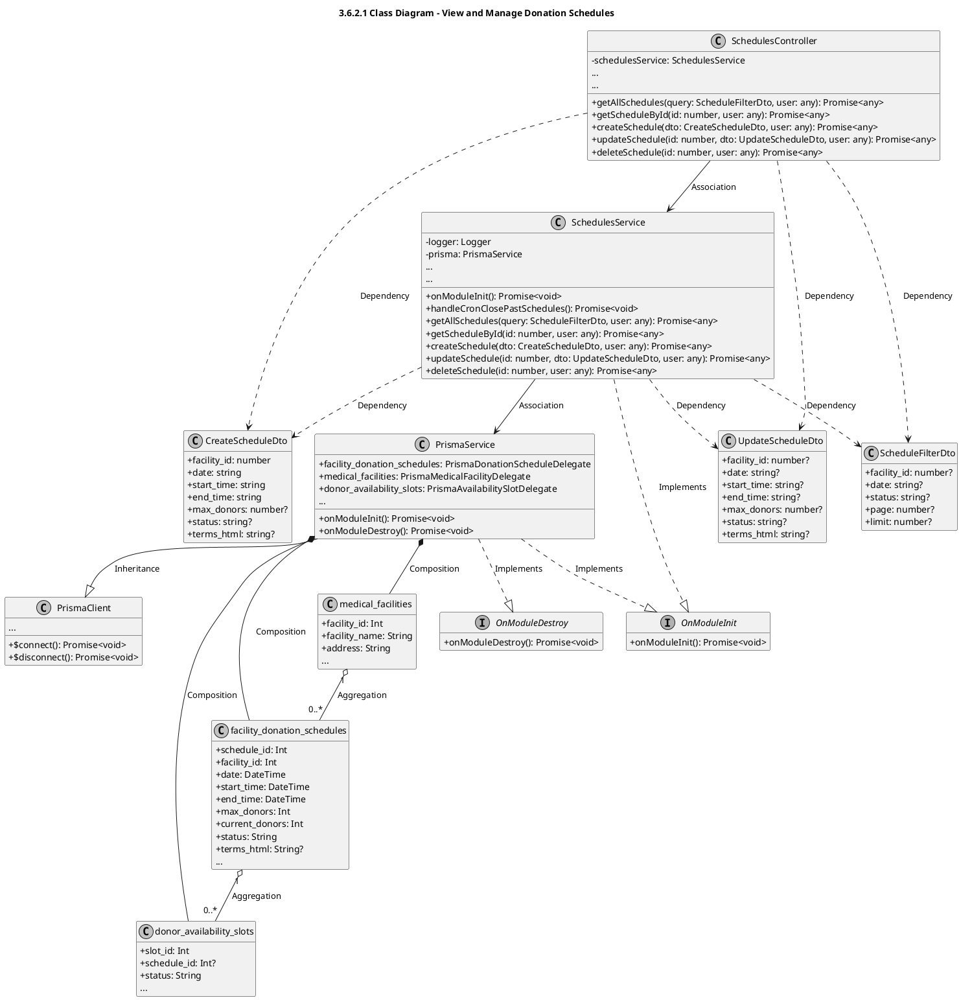
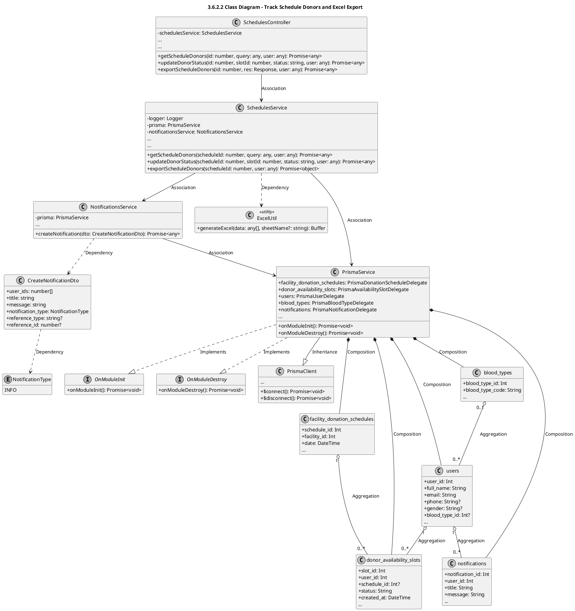

# Module 3.6: Donation Schedule Administration Feature (PlantUML)
> Contains 3 class diagrams.

## 3.6.1 Overview Class Diagram - Donation Schedule Administration Feature (`schedules_overview`)

## 3.6.2.1 Class Diagram - View and Manage Donation Schedules (`schedules_crud`)

## 3.6.2.2 Class Diagram - Track Schedule Donors and Excel Export (`schedules_donors_excel`)

