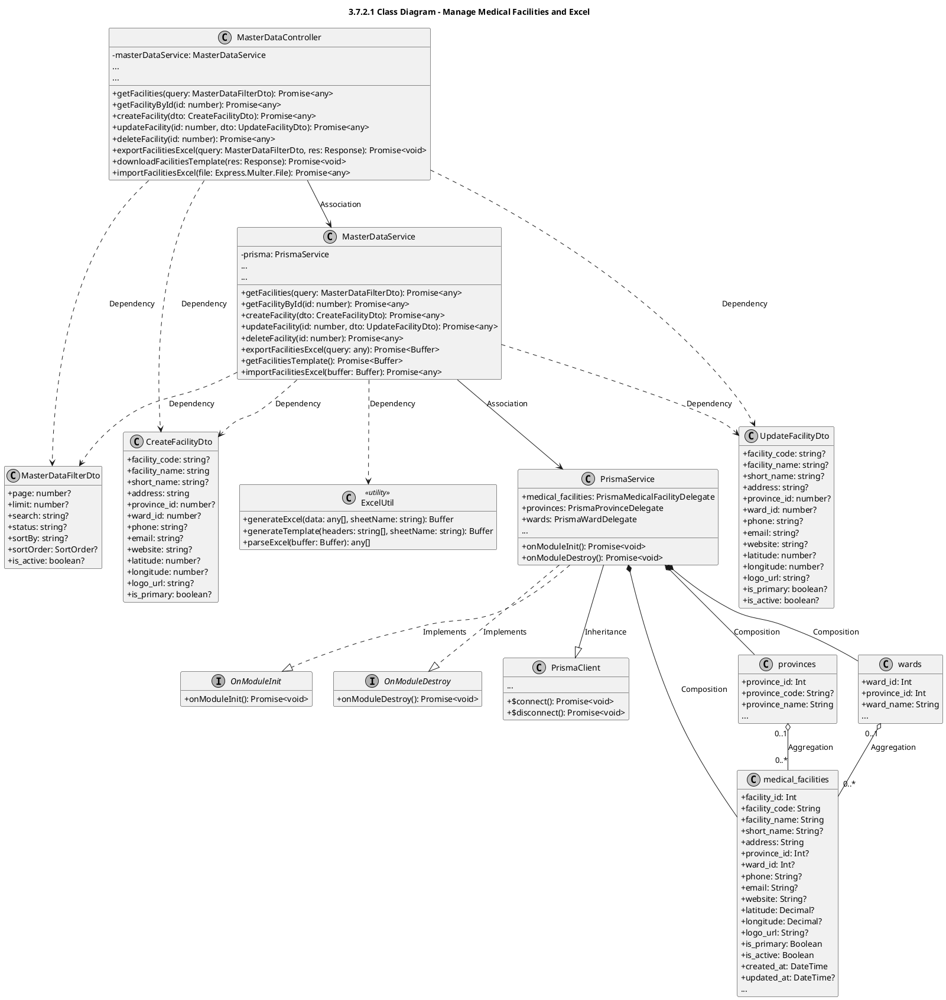
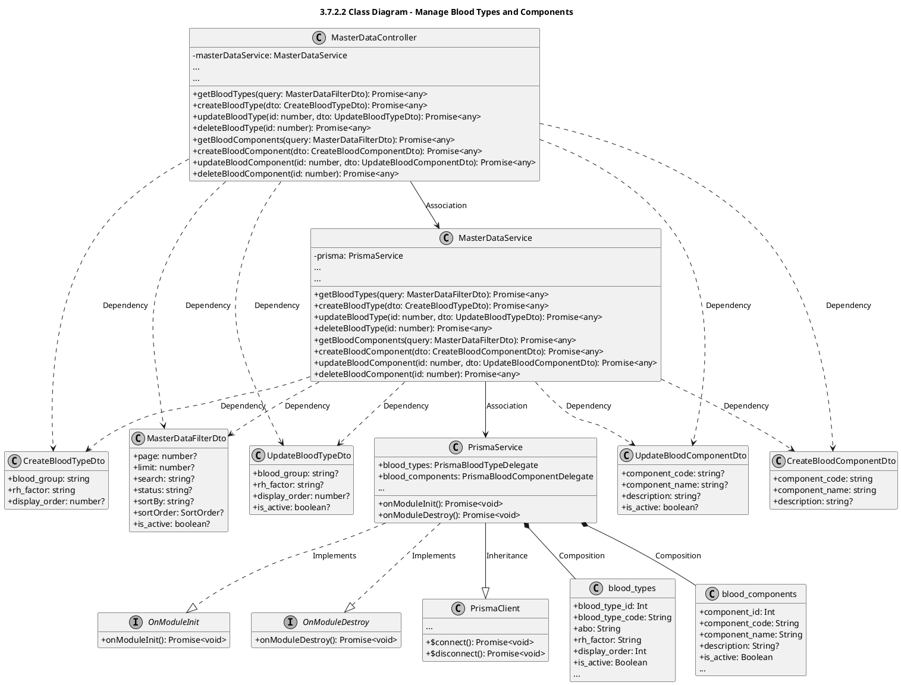
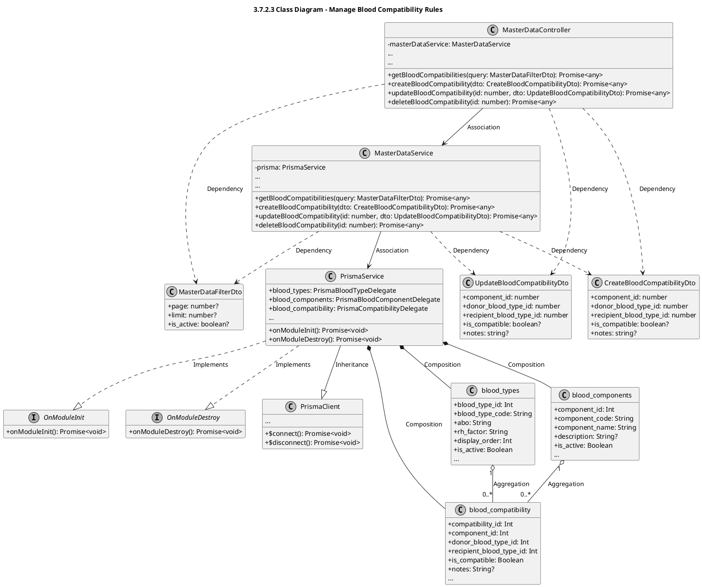
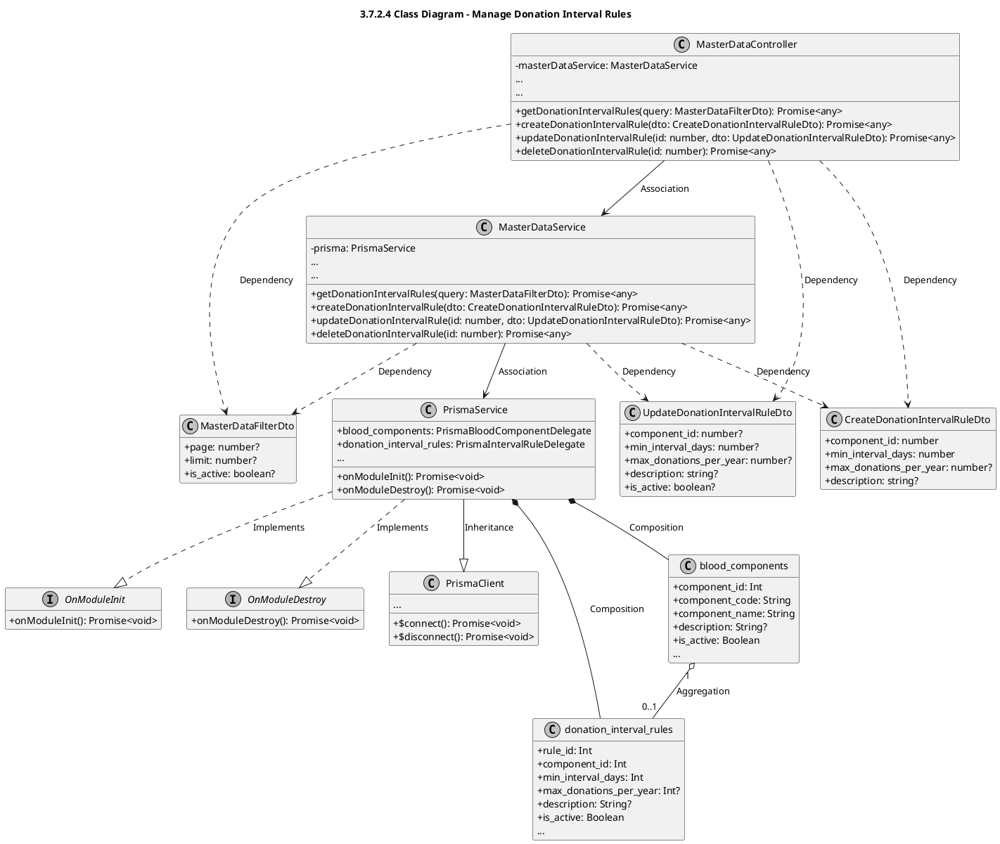
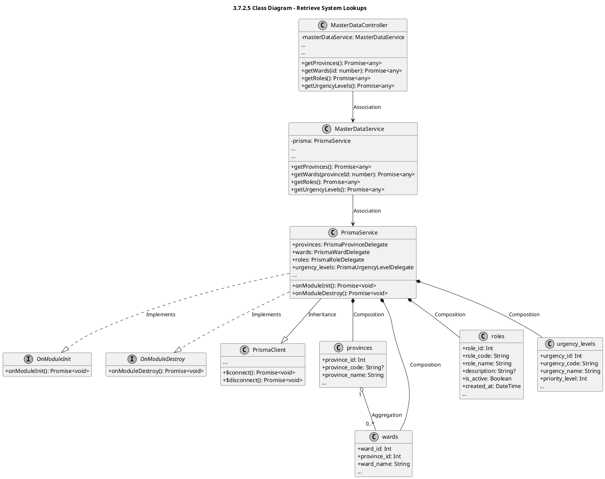

# Module 3.7: Master Data and Facility Administration Feature (PlantUML)
> Contains 6 class diagrams.

## 3.7.1 Overview Class Diagram - Master Data and Facility Administration Feature (`master_data_overview`)

```plantuml
@startuml
title 3.7.1 Overview Class Diagram - Master Data and Facility Administration Feature
skinparam classAttributeIconSize 0
skinparam monochrome true
skinparam shadowing false
skinparam defaultFontName Arial
hide empty members

class MasterDataController {
  -masterDataService: MasterDataService
  +getBloodComponents(query: MasterDataFilterDto): Promise<any>
  +getBloodCompatibilities(query: MasterDataFilterDto): Promise<any>
  +getDonationIntervalRules(query: MasterDataFilterDto): Promise<any>
  +getUrgencyLevels(): Promise<any>
  +getBloodTypes(query: MasterDataFilterDto): Promise<any>
  +getProvinces(): Promise<any>
  +getWards(id: number): Promise<any>
  +getFacilities(query: MasterDataFilterDto): Promise<any>
  +getRoles(): Promise<any>
  +createBloodType(dto: CreateBloodTypeDto): Promise<any>
  +updateBloodType(id: number, dto: UpdateBloodTypeDto): Promise<any>
  +deleteBloodType(id: number): Promise<any>
  +exportFacilitiesExcel(query: MasterDataFilterDto, res: Response): Promise<void>
  +downloadFacilitiesTemplate(res: Response): Promise<void>
  +importFacilitiesExcel(file: Express.Multer.File): Promise<any>
  +getFacilityById(id: number): Promise<any>
  +createFacility(dto: CreateFacilityDto): Promise<any>
  +updateFacility(id: number, dto: UpdateFacilityDto): Promise<any>
  +deleteFacility(id: number): Promise<any>
  +createBloodComponent(dto: CreateBloodComponentDto): Promise<any>
  +updateBloodComponent(id: number, dto: UpdateBloodComponentDto): Promise<any>
  +deleteBloodComponent(id: number): Promise<any>
  +createBloodCompatibility(dto: CreateBloodCompatibilityDto): Promise<any>
  +updateBloodCompatibility(id: number, dto: UpdateBloodCompatibilityDto): Promise<any>
  +deleteBloodCompatibility(id: number): Promise<any>
  +createDonationIntervalRule(dto: CreateDonationIntervalRuleDto): Promise<any>
  +updateDonationIntervalRule(id: number, dto: UpdateDonationIntervalRuleDto): Promise<any>
  +deleteDonationIntervalRule(id: number): Promise<any>
}

class MasterDataService {
  -prisma: PrismaService
  +getBloodComponents(query: MasterDataFilterDto): Promise<any>
  +createBloodComponent(dto: CreateBloodComponentDto): Promise<any>
  +updateBloodComponent(id: number, dto: UpdateBloodComponentDto): Promise<any>
  +deleteBloodComponent(id: number): Promise<any>
  +getUrgencyLevels(): Promise<any>
  +getBloodTypes(query: MasterDataFilterDto): Promise<any>
  +getProvinces(): Promise<any>
  +getWards(provinceId: number): Promise<any>
  +getFacilities(query: MasterDataFilterDto): Promise<any>
  +getRoles(): Promise<any>
  +createBloodType(dto: CreateBloodTypeDto): Promise<any>
  +updateBloodType(id: number, dto: UpdateBloodTypeDto): Promise<any>
  +getFacilityById(id: number): Promise<any>
  +createFacility(dto: CreateFacilityDto): Promise<any>
  +updateFacility(id: number, dto: UpdateFacilityDto): Promise<any>
  +deleteFacility(id: number): Promise<any>
  +exportFacilitiesExcel(query: any): Promise<Buffer>
  +getFacilitiesTemplate(): Promise<Buffer>
  +importFacilitiesExcel(buffer: Buffer): Promise<any>
  +deleteBloodType(id: number): Promise<any>
  +getBloodCompatibilities(query: MasterDataFilterDto): Promise<any>
  +createBloodCompatibility(dto: CreateBloodCompatibilityDto): Promise<any>
  +updateBloodCompatibility(id: number, dto: UpdateBloodCompatibilityDto): Promise<any>
  +deleteBloodCompatibility(id: number): Promise<any>
  +getDonationIntervalRules(query: MasterDataFilterDto): Promise<any>
  +createDonationIntervalRule(dto: CreateDonationIntervalRuleDto): Promise<any>
  +updateDonationIntervalRule(id: number, dto: UpdateDonationIntervalRuleDto): Promise<any>
  +deleteDonationIntervalRule(id: number): Promise<any>
}

class MasterDataFilterDto {
  +page: number?
  +limit: number?
  +search: string?
  +status: string?
  +sortBy: string?
  +sortOrder: string?
  +is_active: boolean?
}

class CreateFacilityDto {
  +facility_code: string?
  +facility_name: string
  +short_name: string?
  +address: string
  +province_id: number?
  +ward_id: number?
  +phone: string?
  +email: string?
  +website: string?
  +latitude: number?
  +longitude: number?
  +logo_url: string?
  +is_primary: boolean?
}

class UpdateFacilityDto {
  +facility_code: string?
  +facility_name: string?
  +short_name: string?
  +address: string?
  +province_id: number?
  +ward_id: number?
  +phone: string?
  +email: string?
  +website: string?
  +latitude: number?
  +longitude: number?
  +logo_url: string?
  +is_primary: boolean?
  +is_active: boolean?
}

class CreateBloodTypeDto {
  +blood_group: string
  +rh_factor: string
  +display_order: number?
}

class UpdateBloodTypeDto {
  +blood_group: string?
  +rh_factor: string?
  +display_order: number?
  +is_active: boolean?
}

class CreateBloodComponentDto {
  +component_code: string
  +component_name: string
  +description: string?
}

class UpdateBloodComponentDto {
  +component_code: string?
  +component_name: string?
  +description: string?
  +is_active: boolean?
}

class CreateBloodCompatibilityDto {
  +component_id: number
  +donor_blood_type_id: number
  +recipient_blood_type_id: number
  +is_compatible: boolean?
  +notes: string?
}

class UpdateBloodCompatibilityDto {
  +component_id: number
  +donor_blood_type_id: number
  +recipient_blood_type_id: number
  +is_compatible: boolean?
  +notes: string?
}

class CreateDonationIntervalRuleDto {
  +component_id: number
  +min_interval_days: number
  +max_donations_per_year: number?
  +description: string?
}

class UpdateDonationIntervalRuleDto {
  +component_id: number?
  +min_interval_days: number?
  +max_donations_per_year: number?
  +description: string?
  +is_active: boolean?
}

class ExcelUtil <<utility>> {
  +generateExcel(data: any[], sheetName: string): Buffer
  +generateTemplate(headers: string[], sheetName: string): Buffer
  +parseExcel(buffer: Buffer): any[]
}

interface OnModuleInit {
  +onModuleInit(): Promise<void>
}

interface OnModuleDestroy {
  +onModuleDestroy(): Promise<void>
}

class PrismaClient {
  +$connect(): Promise<void>
  +$disconnect(): Promise<void>
  ...
}

class PrismaService {
  +medical_facilities: PrismaMedicalFacilityDelegate
  +provinces: PrismaProvinceDelegate
  +wards: PrismaWardDelegate
  +blood_types: PrismaBloodTypeDelegate
  +blood_components: PrismaBloodComponentDelegate
  +blood_compatibility: PrismaCompatibilityDelegate
  +donation_interval_rules: PrismaIntervalRuleDelegate
  +urgency_levels: PrismaUrgencyLevelDelegate
  +roles: PrismaRoleDelegate
  ...
  +onModuleInit(): Promise<void>
  +onModuleDestroy(): Promise<void>
}

class medical_facilities {
  +facility_id: Int
  +facility_code: String
  +facility_name: String
  +short_name: String?
  +address: String
  +province_id: Int?
  +ward_id: Int?
  +phone: String?
  +email: String?
  +website: String?
  +latitude: Decimal?
  +longitude: Decimal?
  +logo_url: String?
  +is_primary: Boolean
  +is_active: Boolean
  +created_at: DateTime
  +updated_at: DateTime?
  ...
}

class provinces {
  +province_id: Int
  +province_code: String?
  +province_name: String
  ...
}

class wards {
  +ward_id: Int
  +province_id: Int
  +ward_name: String
  ...
}

class blood_types {
  +blood_type_id: Int
  +blood_type_code: String
  +abo: String
  +rh_factor: String
  +display_order: Int
  +is_active: Boolean
  ...
}

class blood_components {
  +component_id: Int
  +component_code: String
  +component_name: String
  +description: String?
  +is_active: Boolean
  ...
}

class blood_compatibility {
  +compatibility_id: Int
  +component_id: Int
  +donor_blood_type_id: Int
  +recipient_blood_type_id: Int
  +is_compatible: Boolean
  +notes: String?
  ...
}

class donation_interval_rules {
  +rule_id: Int
  +component_id: Int
  +min_interval_days: Int
  +max_donations_per_year: Int?
  +description: String?
  +is_active: Boolean
  ...
}

class urgency_levels {
  +urgency_id: Int
  +urgency_code: String
  +urgency_name: String
  +priority_level: Int
  ...
}

class roles {
  +role_id: Int
  +role_code: String
  +role_name: String
  +description: String?
  +is_active: Boolean
  +created_at: DateTime
  ...
}

MasterDataController --> MasterDataService : Association
MasterDataController ..> MasterDataFilterDto : Dependency
MasterDataController ..> CreateFacilityDto : Dependency
MasterDataController ..> UpdateFacilityDto : Dependency
MasterDataController ..> CreateBloodTypeDto : Dependency
MasterDataController ..> UpdateBloodTypeDto : Dependency
MasterDataController ..> CreateBloodComponentDto : Dependency
MasterDataController ..> UpdateBloodComponentDto : Dependency
MasterDataController ..> CreateBloodCompatibilityDto : Dependency
MasterDataController ..> UpdateBloodCompatibilityDto : Dependency
MasterDataController ..> CreateDonationIntervalRuleDto : Dependency
MasterDataController ..> UpdateDonationIntervalRuleDto : Dependency
MasterDataService ..> MasterDataFilterDto : Dependency
MasterDataService ..> CreateFacilityDto : Dependency
MasterDataService ..> UpdateFacilityDto : Dependency
MasterDataService ..> CreateBloodTypeDto : Dependency
MasterDataService ..> UpdateBloodTypeDto : Dependency
MasterDataService ..> CreateBloodComponentDto : Dependency
MasterDataService ..> UpdateBloodComponentDto : Dependency
MasterDataService ..> CreateBloodCompatibilityDto : Dependency
MasterDataService ..> UpdateBloodCompatibilityDto : Dependency
MasterDataService ..> CreateDonationIntervalRuleDto : Dependency
MasterDataService ..> UpdateDonationIntervalRuleDto : Dependency
MasterDataService ..> ExcelUtil : Dependency
MasterDataService --> PrismaService : Association
PrismaService --|> PrismaClient : Inheritance
PrismaService ..|> OnModuleInit : Implements
PrismaService ..|> OnModuleDestroy : Implements
PrismaService *-- medical_facilities : Composition
PrismaService *-- provinces : Composition
PrismaService *-- wards : Composition
PrismaService *-- blood_types : Composition
PrismaService *-- blood_components : Composition
PrismaService *-- blood_compatibility : Composition
PrismaService *-- donation_interval_rules : Composition
PrismaService *-- urgency_levels : Composition
PrismaService *-- roles : Composition
provinces "1" o-- "0..*" wards : Aggregation
provinces "0..1" o-- "0..*" medical_facilities : Aggregation
wards "0..1" o-- "0..*" medical_facilities : Aggregation
blood_components "1" o-- "0..*" blood_compatibility : Aggregation
blood_types "1" o-- "0..*" blood_compatibility : Aggregation
blood_components "1" o-- "0..1" donation_interval_rules : Aggregation
@enduml
```

## 3.7.2.1 Class Diagram - Manage Medical Facilities and Excel (`master_data_facilities`)

## 3.7.2.2 Class Diagram - Manage Blood Types and Components (`master_data_blood_types_components`)

## 3.7.2.3 Class Diagram - Manage Blood Compatibility Rules (`master_data_compatibility`)

## 3.7.2.4 Class Diagram - Manage Donation Interval Rules (`master_data_interval_rules`)

## 3.7.2.5 Class Diagram - Retrieve System Lookups (`master_data_lookups`)

