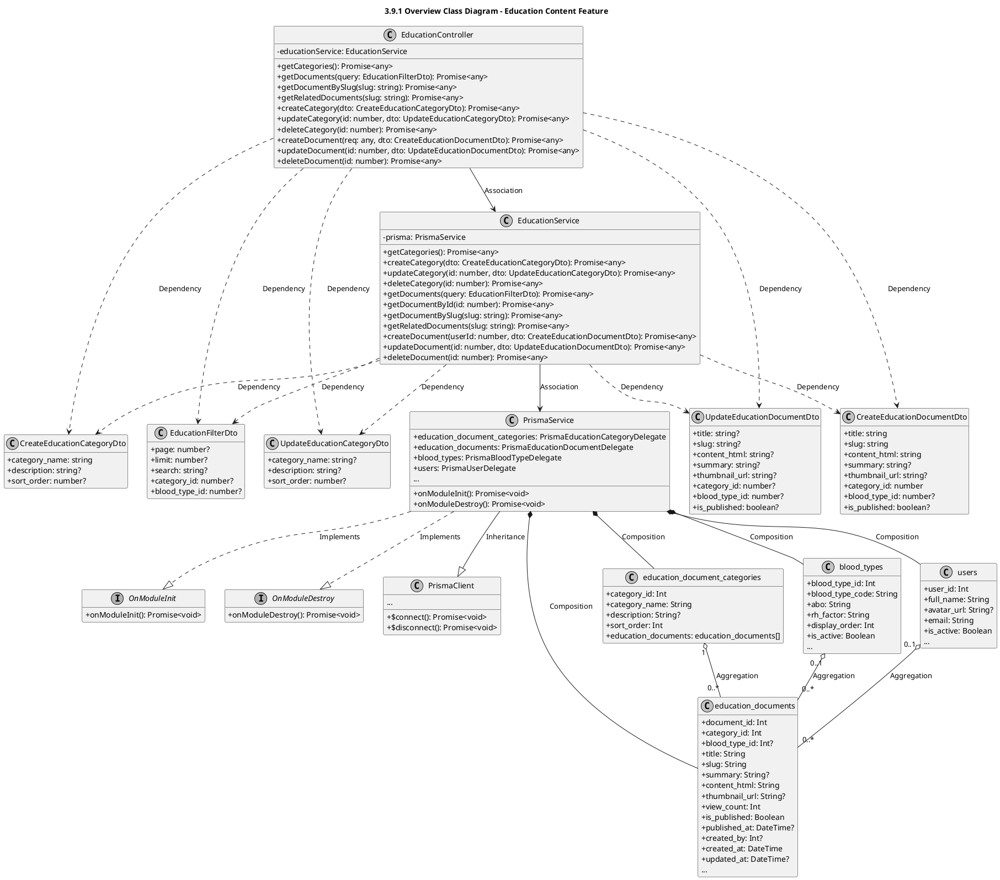
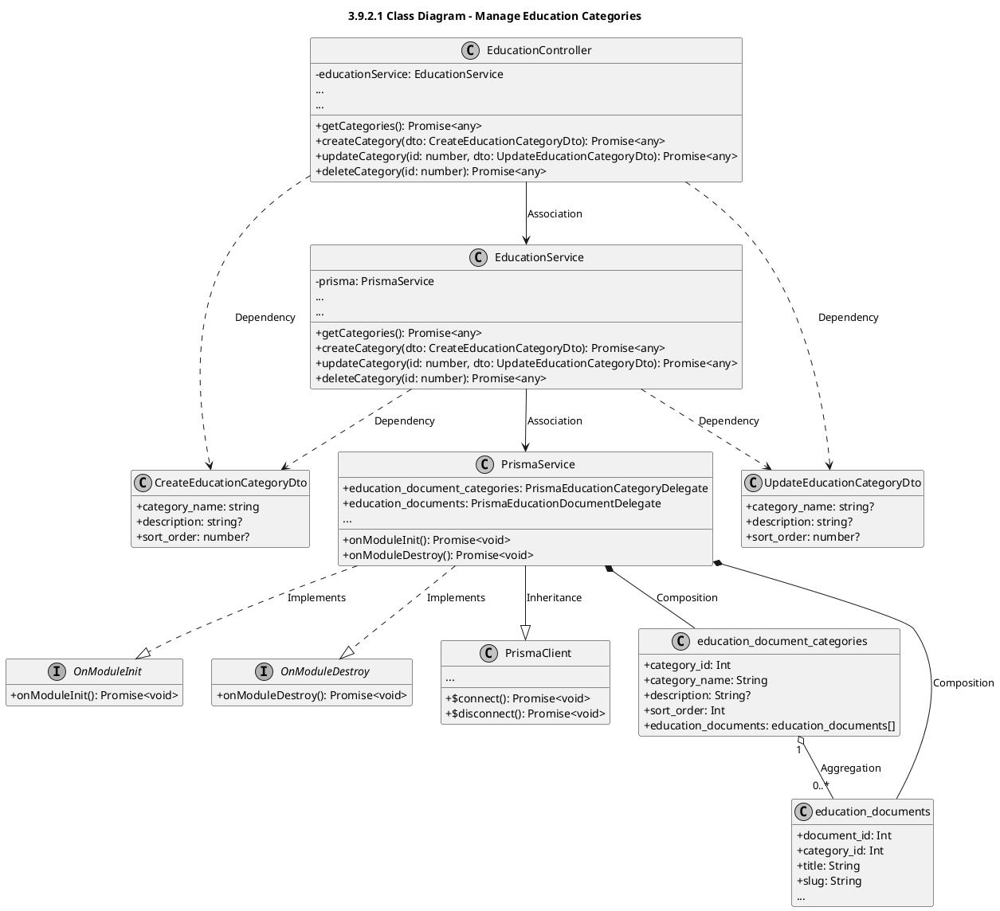
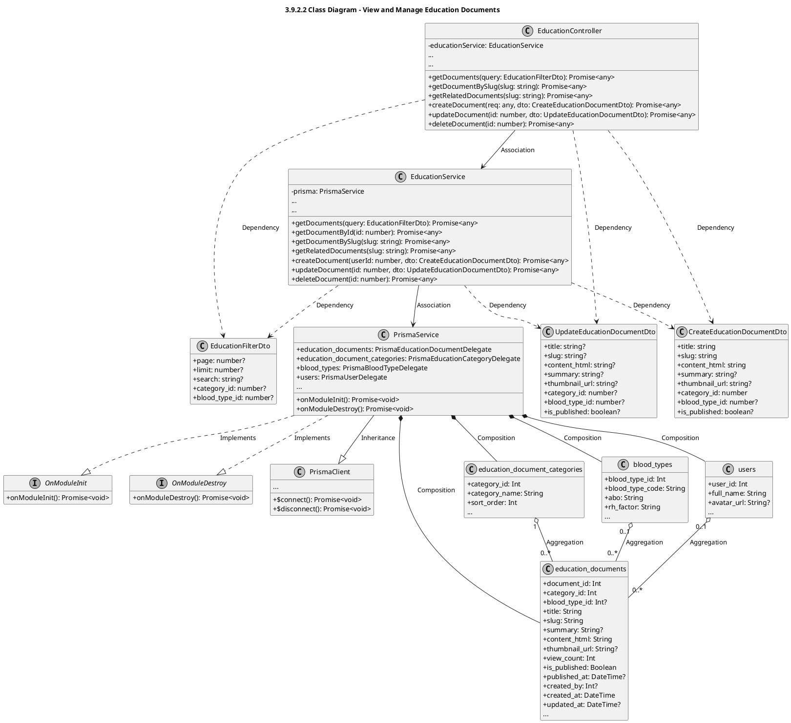

# Module 3.9: Education Content Feature (PlantUML)
> Contains 3 class diagrams.

## 3.9.1 Overview Class Diagram - Education Content Feature (`education_overview`)

## 3.9.2.1 Class Diagram - Manage Education Categories (`education_categories`)

## 3.9.2.2 Class Diagram - View and Manage Education Documents (`education_documents`)

