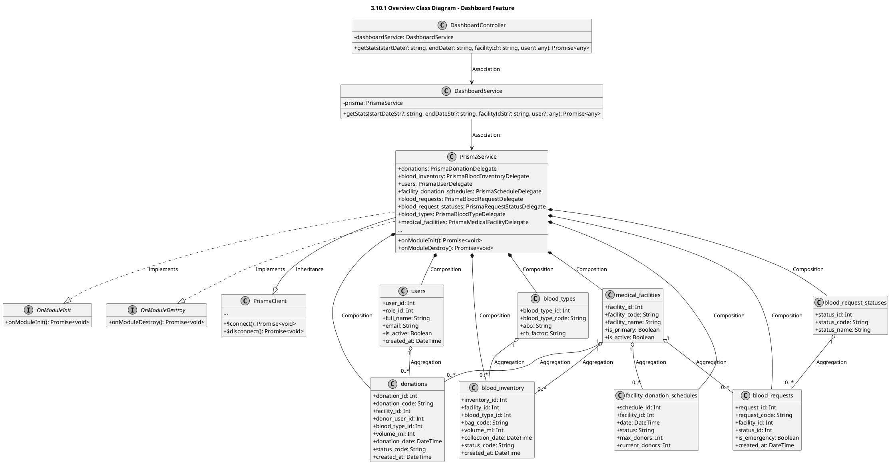
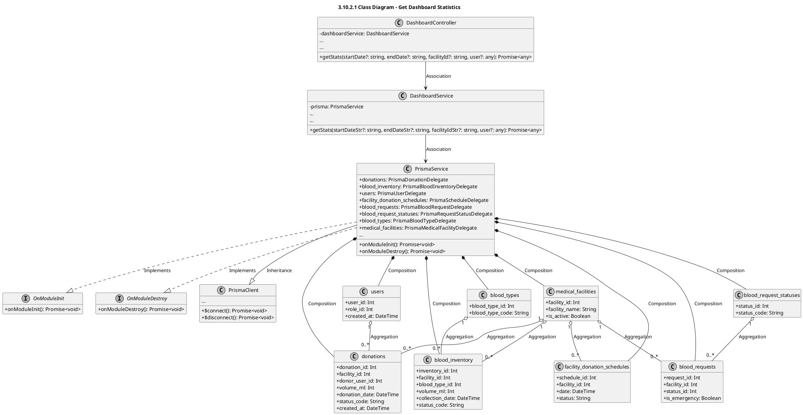

# Module 3.10: Dashboard Feature (PlantUML)
> Contains 2 class diagrams.

## 3.10.1 Overview Class Diagram - Dashboard Feature (`dashboard_overview`)

## 3.10.2.1 Class Diagram - Get Dashboard Statistics (`dashboard_stats`)

