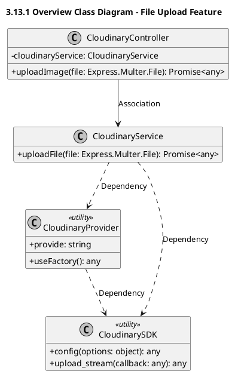
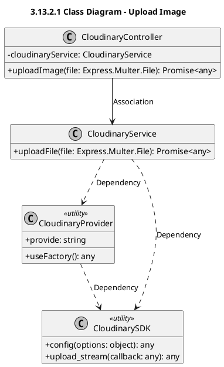

# Module 3.13: File Upload Feature (PlantUML)
> Contains 2 class diagrams.

## 3.13.1 Overview Class Diagram - File Upload Feature (`cloudinary_overview`)

## 3.13.2.1 Class Diagram - Upload Image (`cloudinary_upload`)

